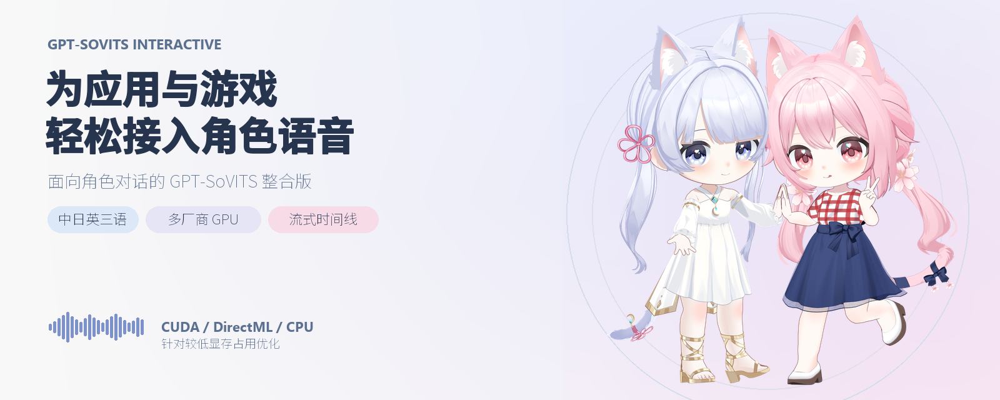

<h1 align="center">GPT-SoVITS Interactive</h1>

<p align="center">
  <a href="README.md">中文</a> ·
  <a href="README.en.md">English</a> ·
  <a href="README.ja.md">日本語</a> ·
  <a href="docs/DISTRIBUTION.md">配布説明</a>
</p>

<p align="center"><strong>ゲームとデスクトップマスコット向けのローカル GPT-SoVITS 音声サービス：生成しながら再生し、1文字ずつタイムラインを返す</strong></p>

<p align="center">
  
</p>

<p align="center">
  <a href="#desktopdaily">私たちのゲーム</a> ·
  <a href="#difference">公式 API との違い</a> ·
  <a href="#quick-start">クイックスタート</a> ·
  <a href="#voices">同梱キャラクター</a> ·
  <a href="#api">API</a> ·
  <a href="#scope">対応範囲</a> ·
  <a href="#performance">性能</a> ·
  <a href="docs/TECHNICAL.ja.md">技術解説</a> ·
  <a href="#license">ライセンス</a>
</p>

台詞をローカルサービスに送ると、生成しながら音声を返し、どの文字がいつ発話されるかも同時に伝えます。字幕のハイライト、表情、動作を同じ再生クロックに合わせられます。文全体の合成を待つ必要も、後から別にアライメントをかける必要もありません。

- **音声と文字を一緒にストリーミング**：各音声チャンクに、リクエスト全体でのサンプル区間と、そのチャンクで新しく発話された文字が付いています。
- **展開するだけで3言語**：Windows 統合パッケージには小春音アミとつくよみちゃんの2人、言語フロントエンド、Python 環境が入っており、中国語・日本語・英語と、それらが混在するテキストをそのまま生成できます。
- **NVIDIA 以外も**：NVIDIA は CUDA、AMD / Intel は DirectML で動き、CPU だけでも使えます。

アプリから呼び出すための推論サービスで、学習機能と WebUI は含みません。キャラクターは上流の GPT-SoVITS（v2ProPlus）で学習してから組み込みます。

<a id="desktopdaily"></a>

## 私たちのゲーム：『デスクトップ日常』

<!-- ゲームのスクリーンショットまたは GIF：キャラクターが話すとき、うなずき・身振り・表情が対応する文字に合う様子。素材は未定。 -->

**[『デスクトップ日常』](https://store.steampowered.com/app/4724470/_/)** は、私たちが制作中の 3D デスクトップマスコットで、Steam で無料配信予定です。つくよみちゃんと小春音アミがあなたのデスクトップに住んでいます。あなたが仕事やネットをしている間、2人は透明なウィンドウの中で自分のことをして過ごし、ときどきあなたに反応します。

- **キャラクターと会話**：自分の API キーと対応する大規模言語モデルをつなぐと、キャラクターが中国語・日本語・英語で返事をし、本リポジトリの TTS がローカルで読み上げます。
- **話しながら演じる**：動作と表情は、大規模言語モデルが台詞と一緒に組み立てます。本リポジトリのストリーミングタイムラインにより、うなずき・身振り・表情が台詞の対応する文字に合わせて入ります。台詞全体の生成を待つ必要もありません。

この TTS は、ゲームのキャラクター対話のために整えたもので、ページ上部の画像はゲームに登場する2人です。気に入っていただけたら、Steam でウィッシュリストに追加したり、私たちをフォローして開発の様子をご覧ください。

- **[Steam ストアページ（ウィッシュリストに追加）](https://store.steampowered.com/app/4724470/_/)** · **[公式サイト](https://www.desksideworks.com)**
- **[Bilibili](https://space.bilibili.com/32459108)** · **[小黑盒](https://www.xiaoheihe.cn/app/user/profile/95841191)** · **[X / Twitter](https://x.com/DesksideWorks)**

<a id="difference"></a>

## GPT-SoVITS 公式 API との違い

モデル構造、重み形式、合成方式は [GPT-SoVITS](https://github.com/RVC-Boss/GPT-SoVITS) を踏襲し、推論コードは [GPT-SoVITS_minimal_inference](https://github.com/GPT-SoVITS-Devel/GPT-SoVITS_minimal_inference) を直接の土台にしています。自己回帰キャッシュ、ONNX グラフ、I/O binding、ストリーミング推論、API などの基礎機能は上流にも既にあります。本リポジトリが行っているのは、それらをアプリの中で使える形にすることです。公式の列のうちインターフェースに関する行は、2026年10月時点の上流 main ブランチの `api_v2.py` と照合しています。

| | GPT-SoVITS 公式 | 本リポジトリ |
|---|---|---|
| 位置づけ | 学習・WebUI・推論をまとめた総合ツール | 推論専用。アプリの横に常駐 |
| ストリーミング出力 | 音声ストリーム（`streaming_mode` 1–3。0 はストリーミングなし） | NDJSON：音声チャンク + サンプル区間 + 1文字ごとのタイムライン |
| どの文字を再生中か | 返さない | 各文字の開始・終了時刻。音声と同じサンプルクロックを使用 |
| キャラクターが他の言語を話す | GPT の条件はリクエスト内の参照録音から | 言語ごとに母語の意味参照を1つ。声質はキャラクター自身のまま |
| 毎回のリクエスト | 参照録音のパスを渡す | 参照特徴量は計算済みで、キャラクター ID だけを渡す |
| サービス管理 | 再起動 / 終了、重みの切り替え | キャラクター切替、GPU の休止と復帰、リクエストの直列実行、切断後の後始末 |

<a id="quick-start"></a>

## クイックスタート

### ダウンロード

統合パッケージは GPU に合わせて2種類あります。コードとキャラクターは同じで、違いは実行環境だけです（CUDA 版には DirectML 専用の GPT グラフが入っていません）。どちらか一方をダウンロードしてください。

- **CUDA 版**（`…-win-x64-cuda`）：NVIDIA GPU。
- **DirectML 版**（`…-win-x64-directml`）：対応する AMD / Intel / NVIDIA GPU。

パッケージは複数の分割ファイル（`.7z.001`、`.7z.002`…）に分かれています。同じ版の分割ファイルをすべて同じフォルダーに置き、[7-Zip](https://www.7-zip.org/) で `.7z.001` を展開してください。どちらの版も CPU で推論できます。GPU 推論には対応するグラフィックスドライバーが必要です。Python と推論用依存関係は同梱環境を使用します。

### 1. サービスを起動する

展開したディレクトリ（この README があるディレクトリ）で PowerShell を開き、GPU に応じてどちらかのコマンドを実行します。コマンドはこのサービス用のアクセストークンを生成・表示します。リクエストに使うので控えておいてください。

**NVIDIA CUDA：**

```powershell
$env:GSV_TTS_TOKEN = [guid]::NewGuid().ToString('N')
Write-Output $env:GSV_TTS_TOKEN
& "./Runtime/Python_CUDA/python.exe" api_server.py --device cuda --cpu_threads 4 --avatar ami --reference default --resources resources --port 8001
```

**DirectML（対応する AMD / Intel / NVIDIA GPU）：**

```powershell
$env:GSV_TTS_TOKEN = [guid]::NewGuid().ToString('N')
Write-Output $env:GSV_TTS_TOKEN
& "./Runtime/Python_DirectML/python.exe" api_server.py --device dml --cpu_threads 4 --avatar ami --reference default --resources resources --port 8001
```

- CPU を使う場合は、`--device cuda` または `--device dml` を `--device cpu` に変更します。`--device auto` は現在の環境で利用可能なバックエンドを選びます。
- `--avatar tyc` にすると、もう1人のキャラクターで起動します。後のリクエストでキャラクターを選ぶこともできます。
- `--device_name` でデバイス名、`--voices_config` でキャラクター設定を指定できます。

サービスの端末を開いたまま、`GSV_TTS_STARTUP` JSON の表示を待ちます。その中の `"ok": true` が準備完了を表します。起動に失敗した場合も同じ行が表示され、`ok` が `false` になり、理由は `code` と `message`（場合によっては `detail` も）に示されます。サービスは本機の `127.0.0.1` だけで待ち受け、ポートは既定で 8001（`--port` で変更可能）です。すべてのリクエストに `Authorization: Bearer <token>` が必要です。

### 2. 最初の音声を生成する

別の PowerShell を開き、プレースホルダーをサービスの端末に表示されたトークンに置き換えて実行します。音声は現在のディレクトリの `speech.wav` に保存されます。

```powershell
$ttsHeaders = @{ Authorization = 'Bearer <サービスが表示したトークン>' }
$ttsBody = @{
    text = 'こんにちは。今日は何を話しましょうか？'
    modelId = 'ami'
    textLang = 'ja'
} | ConvertTo-Json -Compress
Invoke-WebRequest -Uri 'http://127.0.0.1:8001/api/tts/predict' -Method Post -Headers $ttsHeaders -ContentType 'application/json; charset=utf-8' -Body ([System.Text.Encoding]::UTF8.GetBytes($ttsBody)) -OutFile 'speech.wav'
```

`modelId` を `tyc` にするとつくよみちゃんを使用します。`textLang` は `zh`、`ja`、`en`、自動判定の `auto` に対応しています。文章を変えれば、他の言語や混在した対話も試せます。

### 3. 受信しながら再生する：ストリーミング出力

以下のクライアントは Python 標準ライブラリだけを使い、同梱 Python で実行できます。実行前に、クライアント側の端末で `$env:GSV_TTS_TOKEN = '<サービスが表示したトークン>'` を設定してください。PCM をチャンクごとに保存し、タイムラインを表示します。`pcm` をアプリの再生キューに渡せば、受信しながら再生できます。出力する `.f32` ファイルに WAV ヘッダーはありません。

```python
import base64
import json
import os
import urllib.request

payload = {
    "text": "今日は一緒にお茶を飲んで、最近あったことを話そうよ。",
    "modelId": "ami",
    "textLang": "ja",
    "chunkLength": 12,
}
request = urllib.request.Request(
    "http://127.0.0.1:8001/api/tts/predict-stream",
    data=json.dumps(payload, ensure_ascii=False).encode("utf-8"),
    headers={
        "Content-Type": "application/json",
        "Authorization": "Bearer " + os.environ["GSV_TTS_TOKEN"],
    },
)

cursor = 0
finished = False
with urllib.request.urlopen(request, timeout=180) as response, open("speech.f32", "wb") as output:
    for line in response:
        event = json.loads(line)
        if event["type"] == "error":
            raise RuntimeError(event["error"])
        if event["type"] == "chunk":
            pcm = base64.b64decode(event["audio"])
            assert event["audio_start_sample"] == cursor
            assert len(pcm) % 4 == 0
            cursor += len(pcm) // 4
            assert event["audio_end_sample"] == cursor
            output.write(pcm)
            print("chunk", event["chunk_index"], event["audio_start_sample"], event["audio_end_sample"])
            for item in event["timestamps"]:
                print("   ", item["char_idx"], item["char"], f"{item['start']:.2f}", f"{item['end']:.2f}")
        elif event["type"] == "done":
            assert event["audio_end_sample"] == cursor
            finished = True
if not finished:
    raise RuntimeError("Stream ended before the done event")
```

ある回の実行で表示された内容です（RTX 4060 Ti、CUDA。サンプリングにランダム性があるため、数値は毎回少し変わります）。各 `chunk` はすぐに再生できる PCM で、その下の字下げされた行は、このチャンクで新しく発話された文字です。番号、文字、開始と終了の秒数の順に並びます。

```text
chunk 1 0 15360
    0 今 0.12 0.28
    1 日 0.28 0.32
    2 は 0.32 0.56
chunk 2 15360 30720
    3 一 0.56 0.68
    4 緒 0.68 0.86
    5 に 0.86 0.96
chunk 3 30720 46080
    6 お 0.96 1.06
    7 茶 1.06 1.22
    8 を 1.22 1.28
    9 飲 1.28 1.46
chunk 4 46080 61440
    10 ん 1.46 1.48
    11 で 1.48 1.64
    12 、 1.64 1.96
chunk 5 61440 128000
    13 最 1.96 2.24
    14 近 2.24 2.50
    15 あ 2.50 2.58
    16 っ 2.58 2.64
    17 た 2.64 2.74
    18 こ 2.74 2.86
    19 と 2.86 2.98
    20 を 2.98 3.04
    21 話 3.04 3.32
    22 そ 3.32 3.50
    23 う 3.50 3.56
    24 よ 3.56 3.84
    25 。 3.84 4.00
```

<a id="voices"></a>

## 同梱キャラクターと音声素材

| キャラクター | 呼び出し ID | 生成できる言語 | 既定の参照 |
|---|---|---|---|
| 小春音アミ（Ami Koharune） | `ami` | 中国語・日本語・英語・混在テキスト | `default`、計算済み |
| つくよみちゃん | `tyc` | 中国語・日本語・英語・混在テキスト | `default`、計算済み |

両キャラクターは [voices.json](resources/voices.json) に設定済みです。GPT 意味モデルを共有し、それぞれ固有の SoVITS 重みと音響参照キャッシュを使います。言語ごとの意味参照も同梱しており、DirectML 版には DirectML 用の GPT グラフも入っています。リクエストの `modelId` でキャラクターを選択できます。独自キャラクターの追加方法は[後述](#custom)します。

### 音声素材の活用例

ローカルでのキャラクター対話、デスクトップマスコットの応答、ゲーム NPC の台詞、字幕と連動する演出、プロトタイプなどに利用できます。モデル・音響参照・実行設定を統合してあるため、まず API で3言語や混在テキストを試聴し、用途に合うか確認できます。

**条件を守れば無料で商用利用できるキャラクターボイス**を探している方には、小春音アミとつくよみちゃんの音声素材も候補になります。どちらも提供元と利用規約が公開されており、クレジット、キャラクター利用、内容、再配布などの条件に従って利用します。モデルを入手しただけで無条件に商用利用できるわけではありません。商用作品やキャラクターの画像を含む作品を公開する際は、各公式規約と同梱の説明をご確認ください。

- [小春音アミ音声に関する説明](resources/avatars/ami/AMITARO_VOICE_NOTICE.md) · [公式規約](https://amitaro.net/voice/voice_rule/)
- [つくよみちゃん音声に関する説明](resources/avatars/tyc/TSUKUYOMICHAN_VOICE_NOTICE.md) · [キャラクターライセンス](https://tyc.rei-yumesaki.net/about/terms/) · [コーパス規約](https://tyc.rei-yumesaki.net/material/corpus/)

キャラクター音声データ、参照キャッシュ、生成音声には、コードとは別の利用条件が適用されます。詳しくは末尾の[ライセンス説明](#license)をご覧ください。

<a id="3d-models"></a>

### 音声と組み合わせて使える 3D モデル

ページ上部のバナーに登場する、2人のキャラクターの SD スタイル 3D モデルも、**無料でダウンロードでき、モデルの利用許諾とキャラクターの公式規約を守れば商用利用も可能です。モデル利用料・ライセンス料はかかりません**。本リポジトリのキャラクター音声と組み合わせて、デスクトップマスコットやゲーム NPC、対話型アプリなどに活用できます。

- [つくよみちゃん SD ドレスVer.](https://www.desksideworks.com/ja/models/tsukuyomi-chan)
- [小春音アミ SD ふだんぎVer.](https://www.desksideworks.com/ja/models/ami-koharune)

現在公開中の **v1.0** の仕様は次のとおりです（ポリゴン数は三角形換算）。

| 仕様 | つくよみちゃん SD ドレスVer. | 小春音アミ SD ふだんぎVer. |
|---|---|---|
| ポリゴン数（三角形） | 約 96,000 tris | 約 130,000 tris |
| MMD 向け表情 | 64 個 | 64 個 |
| 中間状態 / 補正状態 | 20 個 | 20 個 |
| ARKit 表情 | 52 個 | 52 個 |
| 配布形式 | VRM / Warudo / UnityPackage | VRM / Warudo / UnityPackage |

アプリに組み込んだうえで、本リポジトリが返す音声と文字ごとのタイムラインに合わせて字幕・表情・動作を制御すると、台詞に合わせた演出を作れます。

モデルのプレビュー、ダウンロード、クレジット、利用条件は各公開ページをご覧ください。3D モデルとキャラクター音声にはそれぞれのライセンスが適用されるため、組み合わせて使う際は両方に従ってください。

<a id="credits"></a>

### 音声クレジット

本リポジトリは2人のキャラクターの声で学習したモデルを公開しているため、[つくよみちゃんコーパスの規約](https://tyc.rei-yumesaki.net/material/corpus/)と[あみたろの声素材工房の規約](https://amitaro.net/voice/faq/)に従い、次の内容を目立つ場所に表示する必要があります。

> 本ソフトウェアの音声合成には、フリー素材キャラクター「つくよみちゃん」（© Rei Yumesaki）が無料公開している音声データを使用しています。
>
> ■つくよみちゃんコーパス（CV.夢前黎）<br>
> https://tyc.rei-yumesaki.net/material/corpus/
>
> ■3Dモデル：つくよみちゃん SD ドレスVer.（3D化参考図：橘子tg / 3D制作：CK-迭代型）
>
> ■つくよみちゃん公式サイト<br>
> https://tyc.rei-yumesaki.net/
>
> つくよみちゃんの声質を使用する場合は、出力した音声を次の目的で使用することを禁止します。<br>
> ■人を批判・攻撃すること。（「批判・攻撃」の定義は、[つくよみちゃんキャラクターライセンス](https://tyc.rei-yumesaki.net/about/terms/#condition3)に準じます）<br>
> ■特定の政治的立場・宗教・思想への賛同または反対を呼びかけること。<br>
> ■刺激の強い表現をゾーニングなしで公開すること。<br>
> ■他者に対して二次利用（素材としての利用）を許可する形で公開すること。

> 音声：小春音アミ（CV：あみたろ）<br>
> 学習データ：あみたろの声素材工房（<https://amitaro.net/>）<br>
> あみたろの声素材工房が作成した公式モデルではありません。この音声モデルを利用する場合も、「音声合成モデルに、あみたろの声素材工房（<https://amitaro.net/>）の音声データを使用しています」などのクレジット表記が必要で、[あみたろの声素材工房の利用規約](https://amitaro.net/voice/voice_rule/)の範囲内でのみ使用できます。
>
> ■3Dモデル：小春音アミ SD ふだんぎVer.（3D化参考図：橘子tg / 3D制作：CK-迭代型）

- 本リポジトリのつくよみちゃんは、合成に他の話者のデータも使っています。これは本リポジトリ独自の構成で、つくよみちゃん公式によるものではありません。2人が共有する意味 GPT は小春音アミの素材で学習しており、中国語と英語の発音参照は、Qwen3-TTS で生成した中国語1文と CMU ARCTIC の英語録音1つから取っています。声質はつくよみちゃん自身の SoVITS モデルと参照によるものです。
- 2人の音声モデルも、バナーの 3D モデルも、素材提供元が制作・認定した公式のものではありません。
- 生成音声のクレジットは、それぞれの規約に従います。
  - 小春音アミ：作品内でのクレジット表記が必要です（例：「音声合成モデルに、あみたろの声素材工房（<https://amitaro.net/>）の音声データを使用しています」）。用途も、あみたろの声素材工房の規約の範囲内（全年齢など）に限られます。
  - つくよみちゃん：つくよみちゃん側では生成音声へのクレジットを求めていません（コーパス規約では音声合成ソフトの出力音声を例外としています）。画面に立ち絵や 3D モデルなどのキャラクター素材が出る場合は、[キャラクターライセンス](https://tyc.rei-yumesaki.net/about/terms/)に従ってクレジットを表記します。ただし本リポジトリでは、つくよみちゃんに小春音アミと同じ、アミの素材で学習した GPT を使わせています（本リポジトリの構成で、公式によるものではありません）。そのため本リポジトリで生成したつくよみちゃんの音声にも、上記のあみたろの声素材工房のクレジットが必要で、同じ用途制限を守る必要があります。

<a id="redistribute"></a>

### 自分のアプリでキャラクター音声を配布する

同梱のつくよみちゃんモデルをゲームやアプリに組み込むと、あなたも彼女の声質を使ったソフトを公開することになります（コーパス規約の「③声質を使用した音声合成ソフト等を公開する」）。次の点は自分で満たす必要があります。ここは要約なので、[公式規約](https://tyc.rei-yumesaki.net/material/corpus/)を優先してください。

- **クレジット**：公開前に夢前黎さんにメールしてクレジットの方法を決めるか、公式のクレジット文を目立つ場所に十分な大きさの文字で表示します（有料ソフトは購入前にも見えるようにします）。公式は、利用者に生成音声のクレジットを求めるかどうかに応じて、[必須](https://tyc.rei-yumesaki.net/wp-content/uploads/tsukuyomi-chan_credit_template1.html)・[任意](https://tyc.rei-yumesaki.net/wp-content/uploads/tsukuyomi-chan_credit_template2.html)・[不要](https://tyc.rei-yumesaki.net/wp-content/uploads/tsukuyomi-chan_credit_template3.html)の3種類のテンプレートを用意しています。
- **禁止事項**：上に挙げた4つの用途を、あなたの利用規約で禁止する必要があります。記載しない場合は、先に夢前黎さんに相談してください。
- **混合の明記**：同梱のつくよみちゃんは他の話者のデータを使っているため（上記参照）、あなたの説明にもその旨を記載します。
- **改変と再配布**：あなたのソフトの改変や再配布を許可する場合（コードの一部や音声モデルだけを取り出す場合を含む）は、つくよみちゃんコーパスに由来する部分がコーパス規約に従うことを相手に約束してもらいます。この条件は、さらに下流にも引き継ぐ必要があります。
- **他のキャラクターの声に使う**：彼女の声質をつくよみちゃん以外のキャラクター（自作キャラクターや会話 AI など）の声として使うには、事前に夢前黎さんの許可が必要です。[公式が公開している過去の回答](https://tyc.rei-yumesaki.net/material/corpus/conversational-ai/)では、他のキャラクターがつくよみちゃんの声質で話していることを誰にでも分かるようにすることが求められ、その方法の一つとして画面内にクレジットを表示し続ける案が示されています。それができない場合は、改めて相談してください。生成した音声を他のキャラクターの吹き替えに使うだけなら、そのまま利用できます。

小春音アミの声には、あみたろの声素材工房の[規約](https://amitaro.net/voice/voice_rule/)と[よくある質問](https://amitaro.net/voice/faq/)が適用されます。

- **事前相談**：モデルをソフトやアプリに組み込む場合も、その他の方法で公開・配布する場合も、事前にあみたろの声素材工房への相談が必要です。
- **無料のみ**：彼女の声だけで作ったモデルは、無料でのみ配布できます。ソフトとは別に有料機能を設けてこの声を解放することはできず（あみたろの声素材工房と収益を分け合う場合を除く）、第三者が音声モデルを使えるサービスに登録することもできません。
- **規約を添付**：配布時には、規約へのリンクか、あみたろの声素材工房の Readme を添付します。

<a id="api"></a>

## API

| メソッドとパス | 応答 / 動作 |
|---|---|
| `POST /api/tts/predict` | 完全な WAV |
| `POST /api/tts/predict-timeline` | JSON：Base64 WAV、文字タイムライン、サンプルレート、長さ |
| `POST /api/tts/predict-stream` | NDJSON：逐次 PCM とタイムライン |
| `GET /api/tts/models` | 使用可能なキャラクターと参照設定 |
| `POST /api/tts/switch-model` | キャラクター / 参照を切り替え |
| `GET /api/tts/status` | 状態、バックエンド、デバイス、起動段階の所要時間 |
| `POST /api/tts/hibernate` | 復帰可能な状態を残し、エンジンの GPU モデル / セッション資源を解放 |
| `POST /api/tts/wake` | 復帰、または指定キャラクターをロード |
| `POST /api/tts/benchmark` | 内蔵の短い対話ベンチマーク |
| `POST /v1/audio/speech` | `input` / `voice` を受け取る WAV API |
| `GET /v1/models` | OpenAI 互換のモデル一覧（認証が必要） |
| `GET /v1/voices` | 音声設定一覧（認証が必要） |
| `POST /v1/voices/reload` | 音声設定を再読み込み（認証が必要） |

`/v1/audio/speech` の出力形式は WAV 固定です。受信しながら再生するには `/api/tts/predict-stream` を使います。

### 合成リクエスト

3つの `/api/tts/predict*` エンドポイントは主要フィールドを共有します。

```json
{
  "text": "今天也辛苦了。お疲れさま。Have a good rest!",
  "modelId": "ami",
  "referenceId": "default",
  "textLang": "auto",
  "speed": 1.0,
  "noiseScale": 0.35,
  "topK": 15,
  "topP": 1.0,
  "temperature": 1.0,
  "chunkLength": 12
}
```

- `modelId` に `ami` または `tyc` を指定して同梱キャラクターを選びます。キャラクターと参照を省略すると、現在の設定を使います。`textLang` は `auto`、`zh`、`ja`、`en` に対応します。
- `speed` は話速を調整します。`1.0` はモデルが生成する本来のテンポで、大きくすると速く、小さくすると遅くなります。3言語とストリーミング出力のいずれにも対応します。
- `chunkLength` はストリーミングだけで使う GPT 意味トークンの出力単位です。HTTP の既定値は24、範囲は10–100です。**音声のミリ秒数でも、PCM パケットの固定サイズでもありません**。最初のチャンクまでの時間は、先読み、デコードのコンテキスト、デバイス速度にも左右されます。
- 区切り間の無音は、キャラクターの `defaults.pause_length` から読み込みます。
- 旧リクエストフィールド `g2pPriorityMode`、`languages`、`generateTimeline` は受け付けますが、動作には影響しません。応答の形式はエンドポイントで、言語は `textLang` で決まります。

### ストリーミングイベント

応答は `application/x-ndjson` で、1行に1つの JSON オブジェクトを返します。順序は `start → chunk… → done` です。ストリーム開始後のエラーは `error` イベントで返します。認証の失敗、空のテキスト、存在しないキャラクター、モデルの読み込み失敗など、ストリーム開始前に起きたエラーは HTTP のエラーステータスで返り、NDJSON イベントはありません。

| `chunk` のフィールド | 意味 |
|---|---|
| `audio` | Base64 の**リトルエンディアン float32・モノラル生 PCM**。WAV ヘッダーなし |
| `audio_start_sample` / `audio_end_sample` | リクエスト全体のサンプル区間。開始を含み終了を含まず、順に連続する |
| `sample_rate` / `channels` | 現在のストリーミング実装では 32000 / 1 |
| `chunk_index` | 1から始まるチャンク番号 |
| `timestamps` | このチャンクで新しく返す文字タイムスタンプ。空の場合もある |
| `gpt_finished` | 現在の文の GPT 生成が終了したか。リクエスト全体の終了ではない |
| `is_final` | 音声チャンクは false。完了は `done` イベントで確認 |
| `server_first_chunk_latency_seconds` | サーバーが生成を始めてから最初のチャンクを送るまでの秒数 |

`start` イベントは `sample_rate` と `channels` を返します。`done` イベントは総サンプル数 `audio_end_sample`、チャンク数 `chunk_count`、サーバー側で計測した最初のチャンクまでの時間・総処理時間・音声の長さ（秒）を返します。`error` イベントの `error` フィールドはエラーの説明です。

タイムラインの各項目には `char_idx`、`char`、`start`、`end`、`phones`、`ph_start`、`ph_end`、`approximate` が含まれます。

- `start` / `end` は秒単位で、リクエスト全体の音声の先頭を 0 とします。最初の文字の `start` は通常 0 より大きく、隣り合う文字のあいだが空くこともあります。声のない時間は、句読点の間（ま）でない限り、どの文字にも属しません。
- 各文字は順番に一度だけ返され、送信済みの項目が書き換えられることはありません。正規化で取り除かれた文字（例えば1つの間として読まれる `……`）にも、長さ 0 の項目があります。項目がないのは、文に分けるときに取り除かれる空白だけです。テキストの先頭と末尾の空白、別々に合成される2つの文のあいだの空白がこれに当たります。
- `char_idx` は元テキストの **Unicode コードポイントのインデックス**です。C# / JavaScript では、特に絵文字や補助文字を含む場合、そのまま UTF-16 のインデックスとして扱わないでください。

上の文を別の回に実行したときの、最初の音声チャンクと完了イベントです（`audio` は短縮しています。実際には、各イベントが改行のない1行の JSON です）。

```json
{
  "type": "chunk",
  "audio": "qPObOItAvje7s0W1…",
  "audio_start_sample": 0,
  "audio_end_sample": 15360,
  "sample_rate": 32000,
  "channels": 1,
  "is_final": false,
  "chunk_index": 1,
  "timestamps": [
    {"char_idx": 0, "ph_start": 0, "ph_end": 3, "phones": ["ky", "o", "]"], "start": 0.12, "end": 0.28, "char": "今", "approximate": true},
    {"char_idx": 1, "ph_start": 3, "ph_end": 4, "phones": ["o"], "start": 0.28, "end": 0.32, "char": "日", "approximate": true},
    {"char_idx": 2, "ph_start": 4, "ph_end": 7, "phones": ["w", "a", "UNK"], "start": 0.32, "end": 0.5, "char": "は", "approximate": true}
  ],
  "gpt_finished": false,
  "server_first_chunk_latency_seconds": 0.42941280000377446
}
```

```json
{
  "type": "done",
  "sample_rate": 32000,
  "channels": 1,
  "audio_end_sample": 122880,
  "is_final": true,
  "chunk_count": 5,
  "server_first_chunk_latency_seconds": 0.42941280000377446,
  "server_total_seconds": 0.9300357999745756,
  "audio_duration_seconds": 3.84
}
```

HTTP ストリーミング API は常にタイムラインを計算して返します。Python エンジンの `LatentStream.stream(..., timeline=False)` を直接呼び出せば、この追加出力を無効にできます。同じ推論からタイムラインを得る仕組みは、[技術解説](docs/TECHNICAL.ja.md#streaming-timeline)をご覧ください。

### サービスのライフサイクル

- **リクエストは直列に実行します。** エンジンの状態を変える POST は順番に実行し、ストリーミング応答が終わるまでロックを保持します。先行するストリームがモデルを使っている間に、キャラクター切替・休止・後続の合成がモデルを変更することはありません。クライアントが切断すると、サービスは現在の計算ステップの完了を待ってからジェネレーターを閉じ、精度を戻し、後続の操作を通します。
- **状態の取得では復帰しません。** `/api/tts/status` は状態を読むだけです。
- **休止で GPU リソースを解放します。** PyTorch のモデルとキャッシュを CPU に戻し、ORT DirectML セッションを解放します。プロセスが残っている間は、CUDA コンテキスト、ドライバー、ライブラリが一部の VRAM を使い続けることがあります。

<a id="integration"></a>

### 組み込みのヒント

[『デスクトップ日常』](#desktopdaily)は、ストリーミングタイムラインでキャラクターの演出を動かし、しばらく話さないときは TTS を休止させて VRAM を解放し、次に話す前に復帰させています。ゲームのプレイヤーは次の規則で組み込んでおり、他のアプリでも参考にできます。

- **音声を受信したらすぐキューに入れて再生します。** 音声スレッドは PCM キューだけを消費し、受信側は形式、サンプル区間の連続性、完了時の総サンプル数を確認します。
- **データが足りないときは内容のクロックを止めます。** 再生デバイスが出力を維持するために挿入する無音は台詞の進行に含めないので、次のチャンクを待つ間に字幕・表情・動作が先に進むことはありません。合成結果自体に含まれる間は通常どおり計上します。
- **`done` の後もキューを最後まで再生します。** 生成の終了と再生の終了を分けて判定し、最後の実サンプルを再生し終えてから演出を終えることで、語尾を残します。
- **割り込み時は、リクエストと古い再生キューを両方キャンセルします。** 古い音声を止め、未再生の PCM を捨て、古いリクエストから遅れて届くコールバックを切り離します。
- **実際に再生したサンプル位置を `sample_rate` で割った値で、字幕と演出を動かします。** 1文字が複数の音声チャンクにまたがることも、タイムラインが少し遅れて届くこともあるので、プレイヤーには少しバッファを持たせます。
- **実際に使う言語で最初の準備をします。** 中国語・日本語・英語のフロントエンドは、初めて使うときに読み込まれます。ユーザーが音声の言語を選んだら、その言語の短文で実際のストリーミング API を一度呼び（`textLang` を明示）、音声チャンクと `done` を受け取ってから通常の合成を受け付けます。その待ち時間は準備中として表示します。準備状態はプロセス単位で記録し、休止・復帰後も有効ですが、サービスを再起動したら準備し直します。

また、HTTP ステータスが 2xx 以外の場合、`error` を受け取ったストリーム、`done` を受け取らずに切れたストリームは、いずれも失敗として扱ってください。前半しか読まれていない音声を、完全な結果として使わないでください。

<a id="scope"></a>

## 対応範囲と制限

- **モデルのバージョン**：現在は GPT-SoVITS **v2ProPlus**（32 kHz、意味フレームレート 25 Hz）に対応しています。文内ストリーミングのデコードはモデル構造を確認するため、他のバージョンを組み込むにはデコードパラメータの調整が必要です。
- **学習機能なし**：学習コード、WebUI、ファインチューニングツールはありません。独自キャラクターは、先に上流の GPT-SoVITS で学習してから、[独自キャラクター](#custom)の手順で組み込みます。
- **プラットフォーム**：統合パッケージは Windows x64 版だけで、検証も Windows でのみ行っています。ソースディレクトリにはモデルと実行環境が含まれないため、同じバージョンの統合パッケージから補ってください（[配布説明](docs/DISTRIBUTION.md)を参照）。
- **1つのアプリで専有**：サービスは本機だけで待ち受け、リクエストにはトークンが必要です。同時に実行する推論タスクは1つだけなので、1つのアプリがキャラクターの合成と切り替えをまとめて管理する構成に向いています。
- **タイムラインは近似のアライメント**：SoVITS の注意から導いたもので、字幕のハイライト、文字送り、大まかな動作の同期に向いています。正確な口パクや音素ラベルには、別途アライメントが必要です。日本語の漢字語や英単語の内部の文字境界は近似です。
- **意味参照の適用範囲**：単一言語のリクエストだけに使います（日本語の単語が少し入っただけの中国語は中国語として扱います）。それ以外の中・日・英混在のリクエストでは意味参照を使いません。
- **DirectML**：対応する Windows GPU とドライバーが必要です。GPT グラフの容量は固定（テキスト位置256、KV 位置512）で、長い文章は音素数の予算に応じて自動的に分割されます。上限まで生成しても終わらない場合はエラーになります。AMD はユーザーによる実測が1件だけで、Intel にはまだ実測データがありません。

<a id="performance"></a>

## 性能

RTF = 合成時間 / 出力音声の長さ。小さいほど高速です。例えば **RTF 0.2 は、約1秒で5秒分の音声を生成する速度**です。

| GPU | 推論経路 | 短い対話 RTF ↓ | 中国語長文 RTF ↓ | 専用 VRAM のピーク使用量 |
|---|---|---:|---:|---:|
| NVIDIA RTX 4060 Ti 16GB | CUDA | **0.1955** | **0.1648** | **一括合成で約 0.78 GiB、ストリーミングで約 1.09 GiB** |
| NVIDIA RTX 4060 Ti 16GB | DirectML | **0.2165** | **0.2637** | **約 1.98 GiB** |
| AMD Radeon RX 9070 XT（ユーザー測定） | DirectML | **0.2** | — | **約 1.98 GiB** |

- **精度**：CUDA は PyTorch FP16 を使い、ストリーミング API の音響デコード（flow とボコーダー）だけは一時的に FP32 にします。DirectML は ORT GPT + torch-directml SoVITS で、どちらも FP32 です。表の RTF は一括合成のものです。
- **測定環境**：RTX 4060 Ti の RTF は、同梱の小春音アミモデルを Windows、i5-12600KF、CPU 4スレッドで測定しました（2026-10-11）。AMD の値はユーザーによる実機測定です。
- **短い対話**：内蔵の日本語4セグメントを1リクエストとして合成し、音声は約14秒。タイムラインを有効にし、区切り間の無音は0秒。短文でウォームアップ後、2回の RTF の算術平均を使用。
- **中国語長文**：1,278文字、約4分の音声。当時の旧版中国語プレフィックス（97トークン）を有効にし、区切り間は0.3秒、タイムラインは無効。全文でウォームアップ後、3回の合計処理時間 / 合計音声時間で算出。
- **測定時の版**：表の RTF は、現行の言語ごとの意味参照を追加する前の測定値です。当時、短い対話（日本語）には意味プレフィックスがなく、中国語長文は上記の旧版中国語プレフィックスを使っていました。DirectML はプレフィックスのトークンを1つずつ入力するため、現行版でプレフィックス付きリクエストの DirectML RTF は表より高くなります。CUDA では、最初の音声が出るまでの実測時間はほぼ変わりません。
- **VRAM**：CUDA は現行版を RTX 4060 Ti で、両キャラクター、多言語短文、中国語長文を用いて測定し、一括合成と常駐ストリーミングサービスの両方を含みます。NVIDIA / AMD の DirectML の値は、いずれも非ストリーミング短文のプロセスピークをユーザーが測定したものです。モデル読み込みと合成を含む TTS プロセス全体の専用 VRAM のピークを集計しています。CUDA は共有 GPU メモリも最大約 0.07 GiB 使用しました。`—` は未提供の項目です。
- **計測範囲**：テキスト処理、合成、CPU への波形返却を含み、モデル読み込み、HTTP、保存、再生は含めません。音声時間には設定された区切り間の無音を含みます。実際の性能は機器、言語、文章によって変わります。

対象デバイスでは、`/api/tts/benchmark` で短い対話の RTF を測定でき、`/api/tts/status` で実際に使われている GPT バックエンドと GPU を確認できます。ストリーミングの体験は、最初の音声チャンクまでの時間とプレイヤーのバッファにも左右されます。

<a id="custom"></a>

## 独自キャラクターと開発環境

### ディレクトリとリソース

同梱環境は **Python 3.10** で、CUDA と DirectML はそれぞれ `Runtime/Python_CUDA/` と `Runtime/Python_DirectML/` にあり、依存関係も独立しています。自分で環境を構築する場合、[requirements-cuda-frontend.txt](requirements-cuda-frontend.txt)、[requirements-directml.txt](requirements-directml.txt)、[requirements-chinese.txt](requirements-chinese.txt) はバックエンドやフロントエンドの**追加の依存関係**なので、構築済みの基本推論環境と併用してください。

| リソース | 用途 |
|---|---|
| GPT `.ckpt` と対応する SoVITS `.pth` | 意味生成とキャラクター音響モデル |
| `.cache.pt` 参照キャッシュ | 参照スペクトル、話者埋め込み、バージョン情報。構造は [prompt_cache.py](prompt_cache.py) |
| 中国語 BERT、G2PW、言語識別モデル | ローカルの中国語処理と言語分割。パスと出典は [chinese-runtime-manifest.json](chinese-runtime-manifest.json) |
| NLTK 資産、日本語辞書、フロントエンド依存関係 | 英語・日本語のテキスト処理 |
| `resources/semantic_prompts/` のマニフェストと資産 | 言語ごとの意味参照。GPT ハッシュで適用を判断し、キャラクターに紐づく参照は SoVITS ハッシュも照合 |
| GPT と同名の `.ort-dml/` ディレクトリ（DML のみ） | Prefill / Decode ONNX グラフとハッシュ一覧 |
| `Runtime/Python_CUDA/` と `Runtime/Python_DirectML/` | 独立した2つの Python 環境と推論依存関係 |

一部のフロントエンドと意味参照のリソースは、このディレクトリの `resources/` から読み込みます。`--resources` ですべてのフロントエンドのリソースパスが変わるわけではないため、自分で配置する場合や構成を変える場合も、これらの相対位置を維持してください。

外部のモデルやキャッシュを読み込む場合は、信頼できる提供元のファイルだけを使用してください。PyTorch の重みファイルには実行可能なシリアライズ内容が含まれる場合があります。

### 独自キャラクターを追加する

`resources/voices.json` の既存の `ami` と `tyc` を残し、以下の形式で自分のキャラクターを追加します。`character` は独自 ID の例です。モデルと参照には、使用する権利のあるデータを使ってください。

```json
{
  "character": {
    "name": "My character",
    "gpt_path": "models/character/gpt.ckpt",
    "sovits_path": "models/character/sovits.pth",
    "default_reference_id": "default",
    "references": {
      "default": {
        "name": "Default",
        "cache_path": "avatars/character/references/default.cache.pt"
      }
    },
    "defaults": {
      "text_lang": "auto",
      "speed": 1.0,
      "top_k": 15,
      "top_p": 1.0,
      "temperature": 1.0,
      "noise_scale": 0.35,
      "pause_length": 0.3
    }
  }
}
```

モデルと参照はキャラクターごとに設定でき、複数のキャラクターで同じ GPT 重みを使うこともできます。サービスは必要に応じて1つのアクティブエンジンを切り替え、切り替え時に前のエンジンのモデル資源を解放します。起動方法はクイックスタートと同じで、`--avatar` を新しいキャラクターの ID に変更します。

### 参照キャッシュを作成する

参照キャッシュは1本の参照録音から作ります。ランタイムは録音そのものを読み込みません。先に `voices.json` へキャラクターを追加し、準備環境で次を実行します。

```powershell
python tools/build_prompt_cache.py --voice character --audio reference.wav --text "録音の正確な書き起こし" --language ja --hubert path/to/chinese-hubert-base --sv path/to/pretrained_eres2netv2w24s4ep4.ckpt --sample check.wav
```

- 録音は 3〜10 秒の、雑音の少ないモノラル音声を使ってください。`--text` は録音と一字一句同じにし、`--language` には録音の言語（`zh`、`ja`、`en`）を指定します。
- `--hubert` と `--sv` は上流 GPT-SoVITS の事前学習モデル（[lj1995/GPT-SoVITS](https://huggingface.co/lj1995/GPT-SoVITS) の `chinese-hubert-base/` と `sv/pretrained_eres2netv2w24s4ep4.ckpt`）です。キャッシュ作成時だけ使い、統合パッケージには含まれません。
- キャッシュは `voices.json` にあるその参照の `cache_path` に書き込まれます。既存のファイルを置き換えるときは `--overwrite` を付けてください。書き込む前に、スクリプトはランタイムエンジンで新しいキャッシュを読み込み、短い文を1つ合成します。`--sample` を指定すると、その音声を試聴用に保存します。
- キャラクター専用の日本語意味参照が必要な場合は、[build_semantic_prompt.py](tools/build_semantic_prompt.py) の `--prompt-cache` と `--character-only` で、このキャッシュから作れます。録音が長いほど意味参照も長くなり、最初の音声が遅くなります。

### DirectML GPT グラフを用意する

DirectML 版の同梱 GPT には、そのまま使える DirectML グラフが付いています。GPT 重みを変更する場合は、PyTorch、ONNX、ONNX Runtime のある準備環境で再エクスポートしてください。

```powershell
python tools/export_gpt_dml.py --gpt resources/models/character/gpt.ckpt
```

既定では隣接する `gpt.ort-dml/` に `prefill-p256.onnx`、`step.onnx`、`manifest.json` を生成します。エクスポーターは ONNX 構造と固定サンプルの CPU 数値比較を検証し、実行時にはグラフと GPT 重みのハッシュを確認します。エクスポート後は、対象デバイスで合成と音響比較のスクリプトを実行し、実際の音声を確認できます。

<a id="technical"></a>

## 技術解説

実装の詳細は [docs/TECHNICAL.ja.md](docs/TECHNICAL.ja.md) にまとめています。

- [ストリーミングタイムラインの仕組み](docs/TECHNICAL.ja.md#streaming-timeline)：GPT の生成中から合成を始めます。文字タイムラインは SoVITS の MRTE 注意から直接取り出し、単調アライメントで元テキストの各文字に戻します。
- [多言語の発音、声質、話速](docs/TECHNICAL.ja.md#cross-language)：言語ごとに母語の意味参照を1つ用意して GPT だけに渡し、外国語を話すときの訛りや、引き伸ばし・長い無音・読み落としを減らします。声質はキャラクター自身の音響参照だけから取ります。
- [バックエンドと最適化の選択](docs/TECHNICAL.ja.md#backends)：CUDA・DirectML・CPU それぞれの実装、複数 GPU 環境でのデバイスの照合、参照側と中国語フロントエンドのメモリ最適化。
- [コード案内](docs/TECHNICAL.ja.md#code-map)と[検証スクリプト](docs/TECHNICAL.ja.md#verification)。

<a id="license"></a>

## ライセンスと第三者資産

本リポジトリでは、**独自コード、上流コード、キャラクター音声データ、その他の第三者資産**を分けて扱います。

| 対象 | 適用される条件 |
|---|---|
| 本リポジトリで追加した独自コード | Apache License 2.0。[LICENSE](LICENSE) を参照 |
| GPT-SoVITS / GPT-SoVITS_minimal_inference のコード | それぞれの MIT / Apache-2.0 ライセンスが引き続き適用 |
| 2人のキャラクターのモデル、音響参照、prompt cache、キャラクター名、音声データ | 各公式規約、キャラクター声明、素材提供元の条件が引き続き適用。本リポジトリの Apache ライセンスによる新たな許諾はありません |
| その他の第三者モデル、辞書、ランタイム、資産 | 各自の元のライセンスや利用条件が引き続き適用 |

### 同梱キャラクターの音声の出典

- **小春音アミ（Ami Koharune）**：ローカル SoVITS 音声モデルの学習・音源に [あみたろの声素材工房](https://amitaro.net/) の音声データを使用しています。生成音声や関連データには、同サイトの公式規約が適用されます。
- **つくよみちゃん**：ローカル SoVITS 音声モデルの学習・音源に **つくよみちゃんコーパス Vol.1 声優統計コーパス（JVSコーパス準拠 / CV：夢前黎）** の音声データを使用しています。キャラクターライセンス、コーパス規約、クレジットの条件は、[公式キャラクターライセンス](https://tyc.rei-yumesaki.net/about/terms/)、[つくよみちゃんコーパス](https://tyc.rei-yumesaki.net/material/corpus/)、[クレジット表記について](https://tyc.rei-yumesaki.net/about/terms/credit/)に従います。
- 2人が共有する意味 GPT は小春音アミ由来の素材で学習しており、中国語・英語の意味参照は他の話者に由来します（[TTS_MODEL_AND_DATA_NOTICE.md](TTS_MODEL_AND_DATA_NOTICE.md) を参照）。各 SoVITS 音声モデルの出典と条件は変わりません。ただし GPT の共有は本リポジトリの構成なので、本リポジトリで生成したつくよみちゃんの音声にも、あみたろの声素材工房のクレジットと用途の規定が適用されます（[音声クレジット](#credits)を参照）。
- クレジット文と配布時の条件は、[音声クレジット](#credits)と[自分のアプリでキャラクター音声を配布する](#redistribute)をご覧ください。

### ライセンスファイルと説明

- **GPT-SoVITS**：MIT。[GPT-SoVITS_LICENSE.txt](GPT-SoVITS_LICENSE.txt) を参照。
- **GPT-SoVITS_minimal_inference**：Apache-2.0。[GPT-SoVITS_minimal_inference_LICENSE.txt](GPT-SoVITS_minimal_inference_LICENSE.txt) を参照。
- **本リポジトリの独自コード**：Apache-2.0。[LICENSE](LICENSE) を参照。ファイル内に別の記載がない限り、本リポジトリで追加したコードはこのライセンスで公開します。上流と第三者のコードの元のライセンスは変わりません。
- 変更内容と依存関係の出典：[NOTICE.txt](NOTICE.txt)、[TTS_ENGINE_THIRD_PARTY_NOTICE.md](TTS_ENGINE_THIRD_PARTY_NOTICE.md)。
- モデルと辞書の出典：[TTS_MODEL_AND_DATA_NOTICE.md](TTS_MODEL_AND_DATA_NOTICE.md)。
- 同梱のキャラクターモデルとキャッシュには、[TTS_RUNTIME_NOTICE.md](TTS_RUNTIME_NOTICE.md) と対応するキャラクター声明も適用されます：[小春音アミ](resources/avatars/ami/AMITARO_VOICE_NOTICE.md)、[つくよみちゃん](resources/avatars/tyc/TSUKUYOMICHAN_VOICE_NOTICE.md)。

キャラクター出典：[小春音アミ / あみたろの声素材工房](https://amitaro.net/)（© Amitaro's Voice Material Studio）、[つくよみちゃん](https://tyc.rei-yumesaki.net/)（© Rei Yumesaki）。

**コードとキャラクター音声データには別々の許諾が適用されます。** キャラクターモデル、参照録音、参照キャッシュ、キャラクター名、音声素材を利用・配布する際は、それぞれの許諾に従ってください。
