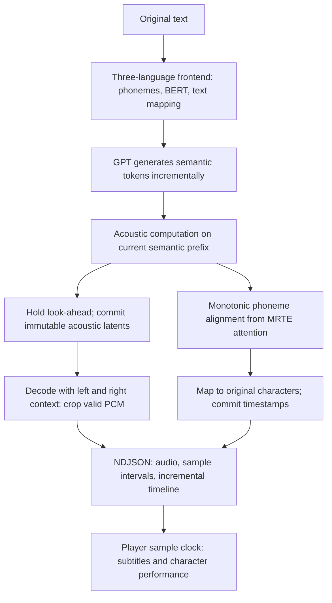

# Technical design

<a href="../README.en.md">← Back to README</a> · <a href="TECHNICAL.md">中文</a> · English · <a href="TECHNICAL.ja.md">日本語</a>

This document explains cross-language pronunciation, streaming audio, timelines, GPU backends, resource lifecycle and semantic conditions. It is useful when replacing models, supporting other devices or extending character expression; it is not required for the quick start.

## Feature summary

- **Bundled three-language voice resources:** models, acoustic references, per-language semantic references, frontend resources and isolated runtimes are included to start a local service directly.
- **In-sentence audio and timeline streaming:** audio chunks can be emitted before GPT finishes the current sentence; character timestamps arrive incrementally. Complete WAV and timeline endpoints are also available.
- **Chinese, Japanese, English and mixed text:** a common text entry point, language segmentation and character-index mapping. Chinese uses G2PW and Chinese RoBERTa; Japanese uses pyopenjtalk; English uses its G2P / NLTK resources.
- **Voice identity and semantic reference are separate:** GPT's semantic reference and SoVITS acoustic conditions are managed independently; voice identity comes only from the character's own weights, reference spectrum and speaker embedding.
- **One native semantic reference per language:** Chinese, English and Japanese each have a semantic prefix tied to GPT weights, reducing the repeated tokens, abnormal lengthening, silence and omissions of reference-free generation. The reference is excluded from audio and timelines; mixed-language requests use no prefix, except Chinese with only Japanese words in it (such as a katakana name), which uses the Chinese one.
- **Device-specific inference:** PyTorch on CUDA; ONNX Runtime GPT and torch-directml SoVITS on DirectML; a CPU route is also available.
- **Multiple GPU vendors on Windows:** DirectML provides a common route for compatible AMD, Intel and NVIDIA devices, matching the physical adapters used by ORT and PyTorch.
- **Acoustic consistency fixes:** explicit channel-wise PReLU broadcasting preserves learned parameters on DirectML; MRTE mask conversion is corrected, with fixed-input numerical comparison scripts.
- **Precomputed references:** cached spectra and speaker embeddings avoid loading reference-side HuBERT / SSL and speaker encoders during ordinary inference.
- **Application lifecycle:** character/reference switching, hibernation, wake-up, startup status, backend diagnostics and serialization throughout streaming responses.
- **GPU matching and integrity checks:** matches frameworks by physical device identity, validates graph/weight correspondence and reports incomplete generation.
- **Inspectable APIs and verification:** local HTTP API, Python engine, fixed short-dialogue benchmark, timeline tests, backend checks and real-model verification scripts.

The current focus is **GPT-SoVITS v2ProPlus, 32 kHz and a 25 Hz semantic frame rate**. In-sentence streaming checks model structure; other versions require matching decoder parameters.

## Cross-language pronunciation, voice identity and speed

Character models often originate from recordings in one language, while applications need the same character to speak several. Reference audio can provide voice identity and also influence pronunciation, rhythm and intonation through GPT semantics. This project separates those roles: voice identity always comes from the character's own acoustic reference, and GPT's semantic condition is chosen by target language.

### One native reference per language, given to GPT only

The original pipeline passed the character's Japanese reference transcript and semantic tokens to GPT, which tends to carry Japanese pronunciation into Chinese and English. Giving GPT no reference at all is not stable enough: some samples produce long runs of repeated semantic tokens, heard as long silence, delayed speech, omitted words or garbled very short lines. These errors occur in GPT output; faster SoVITS or playback cannot restore omitted words.

The runtime keeps one short native-language reference for each language, stored as its **phonemes, text features and semantic tokens**, and supplies it to GPT as a prefix. SoVITS receives only the target phonemes and still uses the character's weights, reference spectrum `refer_spec` and speaker embedding `sv_emb`, so the reference voice does not reach the output.

| Language | Bundled reference | Used by | Size |
|---|---|---|---|
| Chinese | `zh-greeting-v1` | Both characters | 26 phonemes / 87 tokens |
| English | `en-arctic-clb-v1` (CMU ARCTIC) | Both characters | 27 phonemes / 79 tokens |
| Japanese | `ja-ami-v1` | 小春音アミ only | 56 phonemes / 115 tokens |
| Japanese | `ja-tyc-v1` | つくよみちゃん only | 55 phonemes / 81 tokens |

Japanese uses each character's own reference recording, bound to that character by its SoVITS weights. The Chinese and English references are independent of the characters and shared by every character on the same GPT. Sources and licenses are listed in [TTS_MODEL_AND_DATA_NOTICE.md](../TTS_MODEL_AND_DATA_NOTICE.md).

Implementation:

1. Concatenate the reference phonemes / text features with the target text, supply the reference semantic tokens as a GPT prefix, then generate the target portion.
2. Full synthesis removes exactly the prefix token count; streaming delivers only newly generated target tokens downstream. SoVITS receives only target phonemes. Neither audio nor timelines include the reference sentence or its playback duration.
3. Each prefix is stored in a small NPZ with a JSON manifest. The runtime needs no reference WAV and loads no HuBERT / SV extractor.
4. Each manifest records the SHA-256 of the GPT it is bound to; a character-bound manifest also records the SoVITS SHA-256. File hashes, tensor shapes and values are checked. Other GPT weights never use these prefixes; two prefixes for the same language and character, or a damaged asset, cause an error.

Conditions by request:

| Request | GPT condition | SoVITS voice condition |
|---|---|---|
| Entire request is in one language that has an applicable reference | That language's reference prefix | Current character's reference spectrum and speaker embedding |
| Chinese with only Japanese words in it (such as a katakana name), with a Chinese reference | The Chinese reference prefix | Same |
| Other mixed Chinese / Japanese / English (including Chinese with English words) | No semantic reference; no prefix on individual segments | Same |
| Punctuation only, nothing to speak | No semantic reference | Same |
| GPT weights with no bound reference | No semantic reference | Same |

Full and streaming synthesis share language detection and GPT input construction, using the same language spans as the text frontend. In a prefixed request every segment is read in the prefix's language instead of being detected again; read as Chinese, kana words are still read in Japanese. A Japanese sentence containing a Latin-letter word, such as “OKだよ”, counts as a mixed request.

A reference shapes the rhythm and intonation of semantic generation, and an unsuitable one makes generation unstable. When using your own GPT or replacing a reference, check pronunciation and completeness across several texts and random seeds.

Multiple characters can share GPT with separate SoVITS and reference caches. Developers can choose GPT for language performance while retaining acoustic assets. GPT also affects intonation and character expression, so audition replacements with the intended character and language.

### Semantic references and `speed`

A semantic reference influences **which semantic sequence GPT generates**; `speed` controls **how long SoVITS expands it into audio**, using interpolation of acoustic feature sequences. Both can be used together.

`speed=1.0` keeps the model's original rhythm; larger values speed up and smaller values slow down. Chinese, Japanese, English and streaming paths support it. Hosts can offer slow / normal / fast options.

### Mixed languages and normalization

Automatic language detection does not inherit Japanese from the character's reference. In Han-character contexts without kana or Korean, numeric and time expressions retain Chinese context, reducing partial Japanese detection of text such as “3点25分”. Use `textLang: "ja"` for ambiguous all-kanji Japanese or names.

When a sentence has both Han characters and kana, `auto` first decides whether it is Chinese or Japanese: it is Chinese with Japanese words in it when it has less hiragana (not counting honorifics such as ちゃん or さん after a name) than Han characters that do not touch hiragana. In such a sentence Han characters are read in Chinese and kana words (with any Han written into hiragana, as in お疲れさま) in Japanese; with `textLang: "zh"` kana are also read in Japanese. Left to fastText segment by segment, the Han next to a name (我叫 in 我叫コハルネアミ) or a whole clause was often taken for Japanese.

Within one synthesis segment, language frontends process Chinese, Japanese and English separately, then merge phonemes and BERT conditions. A language change alone does not trigger independent waveforms and concatenation. Long text can still split at punctuation or DirectML capacity limits. Alignment after normalization maps back to the user's original text; callers need not replace their subtitles with normalized text.

Implementation: [semantic_prompt.py](../semantic_prompt.py), [run_inference.py](../run_inference.py), [streaming_latents.py](../streaming_latents.py). [build_semantic_prompt.py](../tools/build_semantic_prompt.py) prepares prefixes from a reference recording (encoded with HuBERT in the resource-preparation environment), a character reference cache, or a reviewed semantic-generation record; character acoustic caches are built separately with [build_prompt_cache.py](../tools/build_prompt_cache.py).

## How streaming timelines work

Subtitles and character performances need to track playback. Waiting for the entire sentence before computing timing delays playback; repeatedly regenerating complete audio can change samples already delivered to the player.

The runtime generates audio and timelines in one incremental path, separating acoustic-frame commitment from audio-chunk delivery.

### 1. Start synthesis before GPT finishes

GPT supplies the current prefix in semantic-token chunks. SoVITS computes acoustic features from available tokens, holds back look-ahead and commits earlier acoustic frames. Later tokens never rewrite committed latents.

The default look-ahead is 16 semantic tokens. Local flow / vocoder decoding retains 64 acoustic frames of context, then crops the deliverable region by sample position and concatenates it continuously. It does not hide boundaries with crossfades between independently generated waveforms.

The HTTP streaming endpoint and compatible Python `synthesize_stream()` share this decoder; the latter returns only PCM. Both use the same commitment and context-cropping rules.

Acoustic noise has an independent random source allocated by absolute frame position, so extending a prefix does not change old noise or disturb GPT sampling. Local flow / vocoder decoding uses FP32 during streaming and restores its original precision on completion or cancellation.

Longer sentences can return PCM before EOS. Very short sentences may finish before enough look-ahead and context accumulate. Prefix-based acoustic computation means streaming and full-sentence waveforms can differ.

### 2. Extract the timeline from the same inference

Timing comes directly from SoVITS **MRTE text–acoustic cross-attention**, without an additional ASR pass or independent forced-alignment model after synthesis.

Dynamic programming finds a monotonic phoneme path: each frame can stay on the current phoneme or advance to the next, reducing backward jumps from independent argmax. Frontend phoneme and normalization mappings then recover **character indices in the original request text**.

Silence is scored on its own. A frame without voice does not attend to the phoneme being spoken: most of its attention goes to the last phoneme of the text and some to the punctuation phonemes, wherever they stand. Aligned on each phoneme's own attention alone, the silence before the first word looks like the end of the sentence, and the path hurries there one phoneme per frame, pressing the leading characters into that silence. The alignment therefore gives silence a score of its own, taken from the attention on the last phoneme and on the punctuation phonemes; punctuation phonemes are scored with it, and a silence may also come before any other phoneme. As a result the first character starts where the voice starts instead of at zero, a pause belongs to its punctuation mark, and a pause the text has no mark for is a gap between two characters.

Character-to-phoneme correspondence comes from each language's frontend: Chinese provides it per character; Japanese takes each word's phonemes from Open JTalk's word segmentation, places kana by mora and shares the word's remaining moras among kanji and digits; English takes each word's phonemes and spreads them evenly along its letters. Character boundaries inside a Japanese kanji word or an English word are therefore approximate.

Streaming prefixes use an unfinished mode: they are not forced to cover the sentence's final phoneme or stretch timestamps to the end of its text. Every time more audio exists, the alignment is redone from the attention of the newest acoustic evaluation, because an evaluation that has seen only the opening silence cannot place the characters. A character is emitted with the audio chunk that holds its start, from the alignment of that moment; a character still being spoken waits for the next one. Apart from whitespace dropped when the text is split into sentences, each original index is emitted once, in order, including characters without a phoneme such as an English space, which have zero duration. No character starts before the previous one ended, and published results are never revised. Alignment is an auxiliary output and does not participate in acoustic latents or sampling decisions.

### 3. Share a sample clock for text and audio

Each audio chunk carries global `audio_start_sample` / `audio_end_sample`. Timestamps start at zero for the entire request, including sentence offsets and actual pause samples.

Drive highlights and performance with **actual played sample position / sample_rate**. Audio-chunk and character boundaries are independent: a character may span chunks, and its timing may arrive later. Keep suitable buffering and schedule by timestamps.

The timeline is **approximate character alignment inferred from attention**. Streaming entries carry `approximate: true` and suit subtitle highlighting, text progression and coarse action synchronization. Precise lip-sync or phoneme annotation needs further alignment. Number expansion, punctuation and mixed-language normalization can merge characters or give zero duration. A character the normalization drops (`……` is read as one pause) still has an entry of zero duration where the character before it ends, so every character of a text segment can be looked up by index.

Implementation: [streaming_latents.py](../streaming_latents.py), [timeline.py](../timeline.py), [api_server.py](../api_server.py).

## Backend choices and optimization

| Route | GPT semantics | SoVITS acoustics | Intended use |
|---|---|---|---|
| `cuda` | PyTorch, FP16 by default | PyTorch, FP16 by default | Short dialogue and VRAM balance on NVIDIA |
| `dml` / `directml` | ONNX Runtime DirectML, FP32 | torch-directml, FP32 | Compatible Windows GPUs from more vendors |
| `cpu` | PyTorch, FP32 | PyTorch, FP32 | No GPU or explicit CPU deployment |

These are ordinary inference precisions; streaming local decoding uses the FP32 rules above. GPU routes still perform text processing, sampling or scheduling on CPU.

**CUDA keeps PyTorch.** The choice balances short-dialogue response and VRAM. GPT and acoustic models load original weights directly, without ONNX export. CPU ONNX Runtime in the CUDA environment serves the Chinese frontend.

The single-sequence PyTorch autoregressive path preallocates KV cache and writes later tokens at their positions, reducing repeated concatenation and allocation as sequences grow. It still uses a dynamic valid prefix and is maintained separately from DirectML's fixed graphs.

**DirectML optimizes GPT decoding.** Fixed-shape Prefill / Decode graphs use I/O binding to retain KV cache on GPU rather than copying it all to CPU for every token. Small inputs and logits remain on CPU. Current graphs have 256 text positions and 512 KV positions. The runtime splits long segments by phoneme budget and explicitly reports capacity errors.

ORT and torch-directml adapter indices are matched through DXGI identity rather than reused blindly. GPT graphs disallow automatic CPU-provider fallback. Missing providers, graph/weight mismatches and unavailable devices raise errors. To use CPU GPT explicitly, set `--gpt_device cpu`.

**Match physical GPU identity.** Integrated and discrete GPUs can enumerate in different orders across frameworks. The runtime matches names first; identical names trigger actual GPU-activity probing for the Windows LUID. Wake-up resolves the DXGI index from that identity. ORT providers use physical adapter indices, while I/O binding uses ORT's logical DML allocator number; keeping these separate prevents GPT and SoVITS from landing on different GPUs.

Semantic prefixes use the same DirectML graphs. Prefill processes concatenated text, known semantic-prefix tokens are fed step by step, then target sampling begins. Prefix processing adds computation and occupies KV capacity. The per-segment target budget shrinks with prefix length: 91 phonemes with the bundled Chinese reference, 93 with English, 77 (小春音アミ) / 86 (つくよみちゃん) with Japanese, and 180 without a prefix. Splits prefer punctuation, preserving content and original indices rather than truncating text.

If generation reaches KV or step limits without EOS, the runtime reports an error. `done` confirms HTTP-stream completion; the host must treat `error` or disconnection without `done` as failure rather than a complete utterance.

**Preserve acoustic operator semantics.** The current torch-directml native channel-wise PReLU incorrectly uses a shared slope for `[N, C, 1]` inputs, affecting voice timbre. [ChannelPReLU](../GPT_SoVITS/module/modules.py) explicitly broadcasts learned channel parameters on GPU while retaining checkpoint names. CPU / CUDA use the original implementation. [MRTE](../GPT_SoVITS/module/mrte_model.py) also converts a 0/1 keep-mask into the additive attention bias the interface expects.

**Reduce reference-side memory.** Character spectra and speaker embeddings are cached offline. Chinese BERT loads to CPU on demand, is shared across characters and keeps a bounded 64-entry text-feature cache. The frontend uses the third-from-last hidden layer, so inference loads and computes only the first 22 layers, omitting the last two, prediction head and pooler. The selected weights, FP32 precision and attention implementation are preserved, saving about **100.2 MiB of CPU weight memory**.

**Simplify loading.** GPT constructs the decoder directly with compatible checkpoint names, avoiding Lightning, training optimizers, schedulers and torchmetrics. SoVITS prefers version metadata from the loaded checkpoint to avoid repeated disk reads. Temporary state dictionaries are released after loading; import, read, construction, transfer and warm-up timings are recorded.

DirectML requires a compatible Windows GPU and driver. Inspect the actual GPT backend and adapter through `/api/tts/status` and measure target-device short-dialogue performance with the built-in benchmark.

## Extension: semantic-condition presets

Semantic prefixes offer a way to explore character expression: prepare several conditions for one GPT and vary pauses, rhythm and intonation while retaining character SoVITS and acoustic references. Possible directions include calm statements, lively replies or gentle concern, selected by the dialogue application.

**Today each language has one fixed reference (Japanese has one per character); preset selection and emotion control are not implemented.** Start with condition loading and input construction in [semantic_prompt.py](../semantic_prompt.py), adding selection logic shared by full and streaming synthesis.

Begin with a few presets in one language. Compare rhythm, intonation, identity and content completeness on the same text across multiple random seeds. Conditions affect all of these, so audition them with the target model, especially for renewed repetition, silence or omissions. Each prefix must fit DirectML's prefix and generation capacity budgets.

## Code navigation

| File | Responsibility |
|---|---|
| [run_inference.py](../run_inference.py) | Engine assembly, frontends, full synthesis, lifecycle and benchmark |
| [streaming_latents.py](../streaming_latents.py) | Prefix acoustics, immutable latents, context decoding and stream events |
| [timeline.py](../timeline.py) | MRTE monotonic alignment, text mapping and timestamps |
| [api_server.py](../api_server.py) | Character configuration, local API, authentication and request serialization |
| [semantic_backend.py](../semantic_backend.py) / [ort_gpt.py](../ort_gpt.py) | PyTorch / DirectML GPT and GPU KV management |
| [runtime_backend.py](../runtime_backend.py) / [dxgi_adapters.py](../dxgi_adapters.py) | Backend selection, compatibility and physical GPU matching |
| [prompt_cache.py](../prompt_cache.py) / [semantic_prompt.py](../semantic_prompt.py) | Acoustic reference cache and per-language semantic conditions |
| [chinese_frontend.py](../chinese_frontend.py) | Lazy Chinese BERT loading and feature caching |

## Benchmarks and verification

Call `/api/tts/benchmark` to measure short-dialogue RTF on your device. Streaming experience also depends on first-audio latency and player buffering.

Verification entry points:

- [test_timeline.py](../tests/test_timeline.py): monotonic alignment, where silence and pauses go, order and timing of streamed characters, original-text mapping and time ranges.
- [test_word2ph.py](../tests/test_word2ph.py): Japanese and English character-to-phoneme mapping (needs the frontend resources of the complete package).
- [test_semantic_prompt.py](../tests/test_semantic_prompt.py) / [verify_semantic_prompt.py](../tests/verify_semantic_prompt.py): prefix language selection, GPT and character binding, prefix removal, capacity budgets and real full / streaming generation.
- [test_multilingual_frontend.py](../tests/test_multilingual_frontend.py): language detection, Chinese numeric context and mixed-language processing.
- [test_ort_contract.py](../tests/test_ort_contract.py): DirectML GPT contract.
- [verify_channel_prelu.py](../tests/verify_channel_prelu.py) / [verify_sovits_device_parity.py](../tests/verify_sovits_device_parity.py): channel-wise operators and backend numerical comparisons with fixed semantic/acoustic inputs.
- [verify_frontend_preparation.py](../tests/verify_frontend_preparation.py): feature parity before/after Chinese BERT trimming and frontend preparation.
- [verify_streaming_timeline.py](../tests/verify_streaming_timeline.py): real-model sample continuity, timeline ranges, characters emitted in order without omissions and placed on the voice, and waveform consistency with alignment on/off under fixed randomness.
- [verify_streaming_api.py](../tests/verify_streaming_api.py): HTTP audio/timeline APIs, all three languages and mixed text, hibernation and wake-up after interruption.
- [verify_real_lifecycle.py](../tests/verify_real_lifecycle.py): CPU/CUDA real-model lifecycle checks; optionally pass `--baseline-root` for source comparison.

Real-model scripts use bundled characters and resources. Adjust character IDs and paths through script arguments or configuration for custom models or directory layouts.

Additional checks: [test_lifecycle.py](../tests/test_lifecycle.py), [test_runtime_backend.py](../tests/test_runtime_backend.py), [verify_chinese_api.py](../tests/verify_chinese_api.py), [verify_ort_runtime.py](../tests/verify_ort_runtime.py), [verify_msvc_runtime.py](../tests/verify_msvc_runtime.py) and [benchmark_lifecycle.py](../tests/benchmark_lifecycle.py). See [Distribution](DISTRIBUTION.md) for prerequisites and examples.
