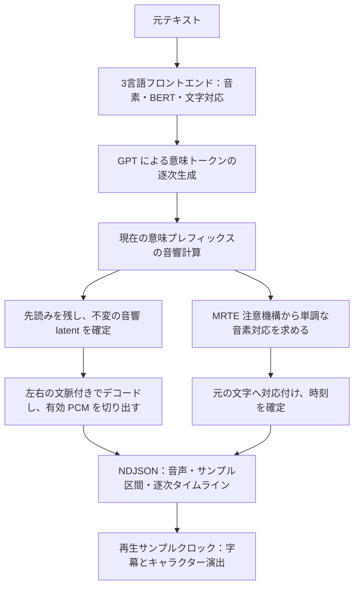

# 技術解説

<a href="../README.ja.md">← README に戻る</a> · <a href="TECHNICAL.md">中文</a> · <a href="TECHNICAL.en.md">English</a> · 日本語

ここでは多言語発音、ストリーミング音声、タイムライン、GPU バックエンド、リソース管理、意味条件を説明します。クイックスタートには不要ですが、モデル変更、別デバイスへの対応、表現の拡張を行う際に参照してください。

## 主な機能

- **同梱の3言語対応キャラクター音声資産**：2人のモデル、音響参照、言語ごとの意味参照、言語資産、独立した実行環境を同梱し、そのままローカルサービスを起動できます。
- **文内ストリーミングとタイムライン**：GPT が現在の文を生成し終える前に音声を出力し、文字タイムラインも逐次返します。完全な WAV とタイムラインの API もあります。
- **中国語・日本語・英語・混在文**：入力、言語分割、文字インデックスを統一。中国語は G2PW と Chinese RoBERTa、日本語は pyopenjtalk、英語は G2P / NLTK 資産を使用します。
- **声質と意味参照の分離**：GPT の意味参照と SoVITS の音響条件を別々に管理。声質はキャラクター自身の重み、参照スペクトル、話者埋め込みだけから得ます。
- **言語ごとの母語の意味参照**：中国語・英語・日本語それぞれに GPT 重みに紐づく意味プレフィックスを用意し、参照なしの生成で起こる繰り返し、異常な引き伸ばし、長い無音、読み落としを改善。参照文は音声とタイムラインに入らず、混在リクエストにはプレフィックスを使いません。ただし日本語の語（カタカナの人名など）だけを含む中国語には中国語のプレフィックスを使います。
- **デバイスに応じた推論**：CUDA は PyTorch、DirectML は ORT GPT と torch-directml SoVITS、CPU 経路も提供します。
- **Windows の複数 GPU メーカーに対応**：DirectML を共通経路とし、ORT と PyTorch が使う物理アダプターを一致させます。
- **バックエンド間の声質修正**：DirectML のチャネル別 PReLU を明示的にブロードキャストして学習済みパラメータを維持。MRTE マスクも変換し、固定音響入力の数値比較スクリプトを用意しています。
- **参照特徴量の事前計算**：スペクトルと話者埋め込みをキャッシュから読み、通常推論時は参照側の HuBERT / SSL と話者特徴抽出モデルをロードしません。
- **組み込み向けライフサイクル**：キャラクター・参照切替、休止・復帰、起動状態、診断、ストリーミング終了までの操作直列化を備えます。
- **複数 GPU と整合性検証**：物理デバイスを照合し、重みとグラフの対応を検証。生成が正常終了しなければエラーを返します。
- **確認可能な API と検証コード**：HTTP API、Python エンジン、短い対話ベンチマーク、タイムライン・バックエンド・実モデルの検証スクリプトを備えます。

現在は **GPT-SoVITS v2ProPlus、32 kHz、意味フレームレート 25 Hz** を主に対象としています。文内ストリーミングはモデル構造を確認するため、他バージョンには対応するデコード設定の調整が必要です。

## 多言語の発音、声質、話速

キャラクターモデルは1つの言語の録音から作られることが多い一方、対話アプリでは同じキャラクターに複数言語を話してもらう必要があります。参照音声は声質だけでなく、GPT の意味条件を通じて発音、リズム、抑揚にも影響します。本プロジェクトはこの2つの役割を分けています。声質は常にキャラクター自身の音響参照から得て、GPT の意味条件は対象言語に応じて別に選びます。

### 言語ごとに母語の参照を1つ用意し、GPT だけに渡す

元の処理ではキャラクターの日本語の参照台詞と参照意味トークンを GPT に渡していたため、中国語や英語を話すときに日本語の発音が混ざりやすくなります。一方、GPT に参照を何も与えないと安定しません。一部のサンプルで長い反復トークンが生成され、長い無音、発話の遅れ、読み落とし、ごく短い台詞の崩れとして現れます。問題は GPT 出力段階で起こるため、SoVITS や再生速度を上げても欠けた文字は戻りません。

本ランタイムは言語ごとに母語の短い参照を1つ用意し、その**音素、テキスト特徴、意味トークン**を保存して GPT のプレフィックス条件にします。SoVITS が受け取るのは対象テキストの音素だけで、キャラクターの重み、参照スペクトル `refer_spec`、話者埋め込み `sv_emb` を引き続き使うため、参照の声質は出力に入りません。

| 言語 | 同梱の参照 | 適用キャラクター | 規模 |
|---|---|---|---|
| 中国語 | `zh-greeting-v1` | 2人で共有 | 26音素 / 87トークン |
| 英語 | `en-arctic-clb-v1`（CMU ARCTIC） | 2人で共有 | 27音素 / 79トークン |
| 日本語 | `ja-ami-v1` | 小春音アミのみ | 56音素 / 115トークン |
| 日本語 | `ja-tyc-v1` | つくよみちゃんのみ | 55音素 / 81トークン |

日本語は各キャラクター自身の参照録音を使い、SoVITS 重みでそのキャラクターに紐づけます。中国語と英語の参照はキャラクターに依存せず、同じ GPT を使うキャラクターで共有します。出典とライセンスは [TTS_MODEL_AND_DATA_NOTICE.md](../TTS_MODEL_AND_DATA_NOTICE.md) を参照してください。

実装の流れ：

1. 参照の音素 / テキスト特徴と対象テキストを連結し、参照の意味トークンを GPT プレフィックスとして与え、対象部分を生成します。
2. 一括合成では正確なプレフィックス長でプレフィックスのトークンを除去し、ストリーミングでは新しく生成した対象トークンだけを下流に渡します。SoVITS が受け取るのは対象音素のみで、参照文は音声にもタイムラインにも入らず、再生時間も増えません。
3. プレフィックスは小さな NPZ と JSON マニフェストに事前保存します。ランタイムは参照 WAV を必要とせず、HuBERT / SV 抽出モデルも読み込みません。
4. 各マニフェストは紐づく GPT の SHA-256 を記録し、キャラクターに紐づくものは SoVITS の SHA-256 も記録します。ファイルハッシュ、テンソル形状、値を検証します。他の GPT 重みには適用されません。同じキャラクターの同じ言語にプレフィックスが2つある場合や、資産が破損している場合はエラーにします。

リクエストごとの条件：

| リクエスト | GPT 条件 | SoVITS 声質条件 |
|---|---|---|
| リクエスト全体が1つの言語で、その言語に適用できる参照がある | その言語の参照プレフィックス | 現キャラクターの参照スペクトルと話者埋め込み |
| 日本語の語（カタカナの人名など）だけを含む中国語で、中国語の参照がある | 中国語の参照プレフィックス | 同上 |
| その他の中国語・日本語・英語の混在（英語を含む中国語を含む） | 意味参照なし。一部の区間だけにプレフィックスを適用しない | 同上 |
| 句読点のみで読む文字がない | 意味参照なし | 同上 |
| GPT 重みに紐づく参照がない | 意味参照なし | 同上 |

言語判定と GPT 入力構築は一括・ストリーミングで共通で、テキストフロントエンドと同じ言語区分を使います。プレフィックス付きのリクエストでは、各区間をプレフィックスの言語で処理し、区間ごとに再判定しません。中国語として処理する場合も、仮名の語は日本語で読みます。ラテン文字の単語を含む日本語（例：「OKだよ」）は混在リクエストとして扱います。

参照は意味生成のリズムと抑揚に影響し、合わない参照は生成を不安定にします。独自 GPT を使う場合や参照を差し替える場合は、複数の文章と乱数 seed で発音と読み上げの完全性を確認してください。

意味モデルと音響モデルは別々に設定でき、複数キャラクターで GPT を共有しつつ各自の SoVITS と参照キャッシュを使えます。言語性能に応じて GPT を選び、音響資産を維持できます。ただし GPT も抑揚やキャラクターの表現に影響するので、変更時は対象のキャラクターと言語で試聴してください。

### 意味参照と `speed` の役割

意味参照は **GPT がどの意味系列を生成するか**に作用し、`speed` は音響特徴系列の補間により **SoVITS がその系列をどの長さの音声に展開するか**を変えます。両者は併用できます。

`speed=1.0` はモデル本来のリズムを使い、大きくすると速く、小さくすると遅くなります。中国語・日本語・英語・ストリーミングで利用でき、アプリで「ゆっくり / 標準 / 速い」などの設定に使えます。

### 混在言語とテキスト正規化

自動言語判定は参照録音の日本語を引き継ぎません。仮名やハングルのない漢字文脈では、数字・時刻表現を中国語の文脈に保ち、「3点25分」の一部を日本語と判定する問題を減らします。漢字のみの日本語や固有名詞が曖昧な場合は `textLang: "ja"` を明示できます。

漢字と仮名が両方ある文では、`auto` はまず文全体が中国語か日本語かを判定します。平仮名の字数（人名の後のちゃん・さん等は数えない）が、平仮名に接していない漢字の字数より少なければ、日本語の語を含む中国語とみなします。その文では漢字を中国語で、仮名の語（お疲れさまのように平仮名に続く漢字も含む）を日本語で読みます。`textLang: "zh"` でも仮名は日本語で読みます。区間ごとに fastText で判定すると、人名の隣の漢字（我叫コハルネアミの「我叫」）や節全体が日本語とされることがよくありました。

同じ合成区間の各言語をそれぞれフロントエンドで処理し、音素と BERT 条件をまとめて合成します。言語が切り替わるだけでは波形を別々に生成・連結しません。長文は句読点や DirectML の容量制限で分割されることがあります。正規化後のアラインメントは元の入力に戻すため、字幕を正規化テキストに置き換える必要はありません。

実装：[semantic_prompt.py](../semantic_prompt.py)、[run_inference.py](../run_inference.py)、[streaming_latents.py](../streaming_latents.py)。[build_semantic_prompt.py](../tools/build_semantic_prompt.py) は参照録音（資産準備環境で HuBERT によりエンコード）、キャラクターの参照キャッシュ、または確認済みの意味生成記録からプレフィックス資産を作ります。キャラクターの音響参照キャッシュは [build_prompt_cache.py](../tools/build_prompt_cache.py) で別に作成します。

## ストリーミングタイムラインの仕組み

字幕や演出には、音声がどこまで再生されたかという情報が必要です。文全体の合成後にタイムラインを計算すると再生開始が遅れ、生成中に音声全体を計算し直すと、既に送った波形が変わる可能性があります。

本ランタイムは音声とタイムラインを同じ逐次推論経路で生成し、「音響フレームの確定」と「音声チャンクの出力」を分けて、プレイヤーへ渡せる内容を決めます。

### 1. GPT 生成中に合成を始める

GPT は意味トークンのチャンク単位で現在のプレフィックスを渡します。SoVITS は得られた範囲の音響特徴を計算し、末尾の先読み部分を残して、それより前のフレームだけを確定します。確定済み latent は後続トークンで書き換えません。

既定では意味トークン16個分の先読みを確保します。局所 flow / vocoder デコードも音響64フレーム分の文脈を保持し、デコード後にサンプル位置で必要な部分を切り出して連続的に連結します。独立した波形の境界をクロスフェードで隠す方式ではありません。

HTTP ストリーミングと互換 Python API `synthesize_stream()` は同じデコーダーを使い、後者は PCM のみを返します。フレーム確定と文脈切り出しの規則は共通です。

音響ノイズは独立した乱数源から絶対フレーム位置に応じて割り当てます。プレフィックスを伸ばしても過去のノイズを変えず、GPT のサンプリングにも干渉しません。ストリーミングの局所 flow / vocoder は FP32 で動かし、終了・キャンセル時に元の精度へ戻します。

長めの文では EOS より前に PCM を返せます。短い文は十分な先読みと文脈が揃う前に GPT が終了することもあります。音響特徴をプレフィックス単位で計算するため、一括合成とは波形が異なる場合があります。

### 2. 同じ推論からタイムラインを取り出す

SoVITS の **MRTE テキスト・音響クロスアテンション**を直接利用し、合成後の ASR や別の強制アラインメントモデルは実行しません。

動的計画法で単調な音素経路を探し、各フレームは現在の音素に留まるか次へ進むだけにします。独立した argmax による後戻りを減らし、フロントエンドの音素対応と正規化対応を使って、**元リクエストの文字インデックス**へ戻します。

無音は別に採点します。声のないフレームは、発話中の音素を指しません。注意の大部分は文の最後の音素に、一部は各所の句読点の音素に向かいます。各音素自身の注意だけで対応を取ると、文頭の無音が文末のように見え、経路は1フレームに1音素ずつそこへ急ぎ、先頭の文字がその無音に押し込まれます。そこで無音に専用のスコアを与え、最後の音素と句読点の音素への注意から求めます。句読点の音素はこのスコアで採点し、ほかの音素の前にも無音を置けるようにしています。その結果、最初の文字は 0 からではなく声の始まりから始まり、間（ま）は対応する句読点に属し、句読点のない間は前後の文字のあいだの空きになります。

文字と音素の対応は言語ごとのフロントエンドから得ます。中国語は文字単位で得られます。日本語は Open JTalk の単語分割で単語ごとの音素を確定し、単語内ではかなをモーラ単位で割り当て、漢字と数字には残りのモーラを均等に配分します。英語は単語ごとの音素を確定し、文字に沿って均等に配分します。そのため、日本語の漢字語の内部と英単語の内部の文字境界は近似です。

ストリーミングのプレフィックスは未完了モードで扱い、文末音素までの到達を強制せず、既存時刻を文全体に引き伸ばしません。音声が増えるたびに、最新の音響計算の注意から対応を取り直します。文頭の無音しか見ていない計算では文字の位置を決められないためです。文字は、その開始位置を含む音声チャンクと一緒に、その時点で最新の対応から返します。発話途中の文字は次回に回します。文に分けるときに取り除かれる空白を除き、元インデックスごとに順番どおり1回だけ出力し、英語の空白のように音素を持たない文字も長さ 0 で出力します。後の文字が前の文字の終わりより早く始まることはなく、返却済み結果は書き換えません。アラインメントは追加出力であり、音響 latent やサンプリング判断に関与しません。

### 3. 音声と文字でサンプル時計を共有する

各チャンクは全体の `audio_start_sample` / `audio_end_sample` を持ちます。時刻の原点はリクエスト音声の先頭で、分割文のオフセットと実際に出力した無音サンプルも同じ時間軸に含めます。

アプリは**実際に再生したサンプル位置 / sample_rate**で字幕と演出を進めます。チャンクと文字の境界は独立しており、1文字が複数チャンクをまたぐ場合や、対応時刻が後から届く場合があります。適切にバッファし、時刻に従って表示してください。

タイムラインは**注意機構から推定した近似的な文字アラインメント**です。ストリーミング項目には `approximate: true` が付き、字幕ハイライト、文字送り、大まかな動作同期に適します。正確な口パクや音素ラベルには追加のアラインメントが必要です。数の展開、句読点、混在言語の正規化によって、文字の結合や長さ0が生じる場合があります。正規化で取り除かれた文字（`……` は1つの間として読まれます）にも、直前の文字の終わりに長さ0の項目が付くため、テキスト区間内のすべての文字をインデックスで引けます。

実装：[streaming_latents.py](../streaming_latents.py)、[timeline.py](../timeline.py)、[api_server.py](../api_server.py)。

## バックエンドと最適化の選択

| 経路 | GPT 意味生成 | SoVITS 音響デコード | 主な用途 |
|---|---|---|---|
| `cuda` | PyTorch、既定 FP16 | PyTorch、既定 FP16 | NVIDIA での短い対話と VRAM のバランス |
| `dml` / `directml` | ONNX Runtime DirectML、FP32 | torch-directml、FP32 | Windows の幅広いメーカーの対応 GPU |
| `cpu` | PyTorch、FP32 | PyTorch、FP32 | GPU がない場合や明示的な CPU 実行 |

表は通常推論の精度です。ストリーミング局所デコードは前述の FP32 規則に従います。GPU 経路でもテキスト処理、サンプリング、スケジューリングの一部は CPU で行います。

**CUDA は PyTorch を維持。** 短い対話の応答と VRAM を考慮し、GPT と音響モデルは元の重みを直接読み込みます。ONNX エクスポートは不要です。CUDA 環境の CPU ONNX Runtime は中国語フロントエンド用です。

PyTorch の単一系列自己回帰経路は KV キャッシュを事前確保し、後続トークンを所定位置に書き込んで、系列が伸びる際の連結・再確保を減らします。有効プレフィックスは動的であり、DirectML の固定グラフとは別実装です。

**DirectML は GPT デコードを最適化。** 固定形状の Prefill / Decode グラフと I/O binding で KV キャッシュを GPU 上に維持し、トークンごとの全キャッシュの CPU 転送を避けます。小さな入力と logits は CPU 側で扱います。現グラフはテキスト256位置、KV 512位置で、長文を音素予算に沿って分割し、容量不足は明示的にエラーとします。

ORT と torch-directml のアダプター番号は直接流用せず、DXGI のデバイス識別で照合します。GPT グラフの自動 CPU provider フォールバックは禁止し、provider 不足、グラフと重みの不一致、選択デバイスが使えない場合はエラーを返します。CPU GPT が必要なら `--gpt_device cpu` を明示できます。

**複数 GPU は物理識別で一致させる。** 内蔵 GPU と独立 GPU の列挙順はフレームワークごとに異なることがあります。名前で照合し、同名の場合は実際の GPU 活動から Windows LUID を検出します。復帰時はその識別情報から DXGI インデックスを解決します。ORT provider は物理アダプター番号、I/O binding は ORT 論理 DML allocator 番号を使うため別々に管理し、GPT と SoVITS の意図しない別 GPU 配置を防ぎます。

意味プレフィックスも同じ DirectML グラフを使います。Prefill が連結テキストを処理し、既知の意味プレフィックスを順に入力した後、対象トークンをサンプリングします。プレフィックスは区間ごとに追加計算と KV 容量を必要とするため、区間ごとの対象音素の予算はプレフィックス長に応じて小さくなります。同梱の中国語参照で91、英語で93、日本語で77（小春音アミ）/ 86（つくよみちゃん）、プレフィックスなしで180です。句読点付近を優先して分割し、本文と元インデックスを保ち、容量のために文字を切り捨てません。

EOS に達せず KV またはステップ上限に達した場合はエラーになります。HTTP ストリームは `done` で完了を確認し、`error` や `done` なしの切断は、途中までの音声を完成扱いせず失敗として処理してください。

**音響演算の意味を保つ。** 現在の torch-directml は `[N, C, 1]` 入力のチャネル別 PReLU に共有傾きを誤って使い、声質に影響します。[ChannelPReLU](../GPT_SoVITS/module/modules.py) は学習済みチャネルパラメータを GPU 上で明示的にブロードキャストし、元の checkpoint パラメータ名も保ちます。CPU / CUDA は元実装を使います。[MRTE](../GPT_SoVITS/module/mrte_model.py) では 0/1 keep-mask を注意機構の要求する加算 bias に変換しています。

**参照側の常駐メモリを削減。** 参照スペクトルと話者埋め込みは事前キャッシュにします。中国語 BERT は初回必要時に CPU へ読み込み、キャラクター間で共有し、最大64件のテキスト特徴キャッシュを保持します。フロントエンドは後ろから3番目の隠れ状態を使うため、先頭22層のみをロード・計算し、最後の2層、単語予測ヘッド、pooler を省きます。対象層の重み、FP32、注意機構を保ったまま、**CPU 重みメモリを約 100.2 MiB 削減**します。

**読み込み処理を簡素化。** GPT は checkpoint の名前を保ってデコーダーを直接構築し、Lightning、学習用 optimizer、scheduler、torchmetrics の読み込みを避けます。SoVITS はロード済み checkpoint のバージョン情報を優先し、再読み込みを減らします。一時 state dict をロード後に解放し、import、読み込み、構築・転送、ウォームアップなどの時間を記録します。

DirectML には対応 Windows GPU とドライバーが必要です。`/api/tts/status` で実際の GPT バックエンドとアダプターを確認し、内蔵ベンチマークで対象機器の短い対話性能を測定できます。

## 拡張の方向：意味条件のプリセット

意味プレフィックスはキャラクターの表現を探る手がかりになります。同じ GPT に複数の意味条件を用意し、SoVITS と音響参照を保ったまま、間・リズム・抑揚を変える方向です。例えば落ち着いた説明、軽快な返答、やさしい気遣いなどを試し、アプリが場面に応じて選ぶことが考えられます。

**現時点では言語ごとに固定の参照を1つ（日本語はキャラクターごとに1つ）提供しており、複数プリセットの選択や感情制御は未実装です。** [semantic_prompt.py](../semantic_prompt.py) の条件読み込みと入力構築を起点に選択処理を追加し、一括とストリーミングで共通化できます。

まず1言語の少数プリセットから始め、同じテキストと複数の乱数 seed でリズム、抑揚、声質、内容の完全性を比べてください。意味条件はこれら全てに作用するため、対象モデルでの試聴が必要です。特に反復、長い無音、読み落としが再発しないか確認します。各プリセットの長さを DirectML のプレフィックス・生成容量予算に含める必要もあります。

## コード案内

| ファイル | 役割 |
|---|---|
| [run_inference.py](../run_inference.py) | エンジン構成、フロントエンド、一括合成、ライフサイクル、ベンチマーク |
| [streaming_latents.py](../streaming_latents.py) | プレフィックス音響計算、不変 latent、文脈付きデコード、イベント |
| [timeline.py](../timeline.py) | MRTE 単調アラインメント、文字対応、タイムスタンプ |
| [api_server.py](../api_server.py) | キャラクター設定、ローカル API、認証、直列化 |
| [semantic_backend.py](../semantic_backend.py) / [ort_gpt.py](../ort_gpt.py) | PyTorch / DirectML GPT と GPU KV 管理 |
| [runtime_backend.py](../runtime_backend.py) / [dxgi_adapters.py](../dxgi_adapters.py) | バックエンド選択、互換処理、物理 GPU 照合 |
| [prompt_cache.py](../prompt_cache.py) / [semantic_prompt.py](../semantic_prompt.py) | 音響参照キャッシュと言語ごとの意味条件 |
| [chinese_frontend.py](../chinese_frontend.py) | 中国語 BERT の遅延読み込みと特徴キャッシュ |

## 性能測定と検証スクリプト

`/api/tts/benchmark` で対象機器の短い対話 RTF を測定できます。ストリーミング体験は最初の音声までの遅延と再生バッファにも依存します。

主な検証入口：

- [test_timeline.py](../tests/test_timeline.py)：単調対応、無音と間の帰属、ストリーミングでの出力順と出力時期、元テキストへの復元、時間範囲。
- [test_word2ph.py](../tests/test_word2ph.py)：日本語・英語の文字と音素の対応（完全パッケージのフロントエンド資源が必要）。
- [test_semantic_prompt.py](../tests/test_semantic_prompt.py) / [verify_semantic_prompt.py](../tests/verify_semantic_prompt.py)：プレフィックスの言語選択、GPT とキャラクターへの紐づけ、プレフィックス除去、容量予算、実際の一括 / ストリーミング生成。
- [test_multilingual_frontend.py](../tests/test_multilingual_frontend.py)：言語識別、中国語の数字文脈、混在言語。
- [test_ort_contract.py](../tests/test_ort_contract.py)：DirectML GPT のインターフェース仕様。
- [verify_channel_prelu.py](../tests/verify_channel_prelu.py) / [verify_sovits_device_parity.py](../tests/verify_sovits_device_parity.py)：チャネル別演算、固定意味・音響条件でのバックエンド数値比較。
- [verify_frontend_preparation.py](../tests/verify_frontend_preparation.py)：中国語 BERT 簡素化前後の特徴比較と準備処理。
- [verify_streaming_timeline.py](../tests/verify_streaming_timeline.py)：実モデルでのサンプル連続性、時間範囲、文字が順番どおり漏れなく出力され声と重なること、乱数固定時のタイムライン有無による音声一致。
- [verify_streaming_api.py](../tests/verify_streaming_api.py)：HTTP 音声 / タイムライン、3言語・混在文、中断後の休止・復帰。
- [verify_real_lifecycle.py](../tests/verify_real_lifecycle.py)：CPU/CUDA の実モデルでライフサイクルを検証。`--baseline-root` で旧ソースとの比較も可能。

実モデル用スクリプトは同梱キャラクターとリソースを使います。独自モデルや別のディレクトリ構成では、引数や設定で ID とパスを調整してください。

追加の検証：[test_lifecycle.py](../tests/test_lifecycle.py)、[test_runtime_backend.py](../tests/test_runtime_backend.py)、[verify_chinese_api.py](../tests/verify_chinese_api.py)、[verify_ort_runtime.py](../tests/verify_ort_runtime.py)、[verify_msvc_runtime.py](../tests/verify_msvc_runtime.py)、[benchmark_lifecycle.py](../tests/benchmark_lifecycle.py)。前提条件と実行例は[配布説明](DISTRIBUTION.md)を参照してください。
