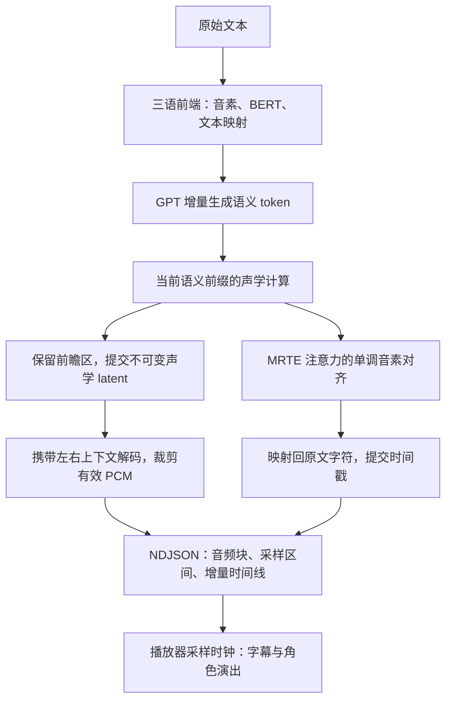

# 技术方案解析

<a href="../README.md">← 返回 README</a> · 中文 · <a href="TECHNICAL.en.md">English</a> · <a href="TECHNICAL.ja.md">日本語</a>

本文说明这个运行时如何处理跨语言发音、流式音频、时间线、多 GPU 后端、资源生命周期和语义条件。快速使用不需要阅读本文；如果要替换模型、接入其他设备或扩展角色表达，可以从这里开始。

## 特性总览

- **随包可用的三语角色资源**：两位角色的模型、声学参考、各语言的语义参考、语言前端资源与独立运行环境随包提供，可直接启动本地服务。
- **句内流式音频与时间线**：在当前句子的 GPT 语义生成结束前即可输出音频块，字符时间线随块增量返回；也提供完整 WAV 与完整时间线接口。
- **两位角色均支持中日英与混合文本**：统一的文本入口、语言分段和字符索引映射。中文使用 G2PW 与 Chinese RoBERTa，日文使用 pyopenjtalk，英文使用相应 G2P / NLTK 资源。
- **分离角色音色与语义参考**：GPT 的语义参考与 SoVITS 的角色声学条件分别管理，音色只来自角色自己的权重、参考频谱和说话人嵌入。
- **每种语言一份母语语义参考**：中文、英文、日文各有与 GPT 权重绑定的语义前缀，改善无参考生成中出现的重复 token、异常拖长、长静音与漏读。参考内容不会进入输出音频或时间线；混合语言请求不使用前缀，只夹了日文词（如片假名人名）的中文仍按中文使用前缀。
- **按设备选择推理实现**：CUDA 使用 PyTorch；DirectML 使用 ONNX Runtime GPT 与 torch-directml SoVITS；另有 CPU 路线。
- **面向 Windows 多厂商 GPU**：DirectML 为 AMD、Intel 和 NVIDIA 的兼容设备提供共同路径，并匹配 ORT 与 PyTorch 使用的物理适配器。
- **后端音色一致性修正**：针对 DirectML 的逐通道 PReLU 实现显式广播，保留训练得到的通道参数；修正 MRTE 注意力掩码的语义转换，并提供固定声学输入的数值对照脚本。
- **预计算角色参考特征**：加载参考频谱与说话人嵌入缓存，日常推理无需加载参考侧 HuBERT / SSL 与说话人特征提取模型。
- **适合嵌入应用的生命周期**：角色与参考切换、休眠与唤醒、启动状态、后端诊断，以及贯穿流式响应的操作串行化。
- **多显卡设备匹配与完整性检查**：按物理设备身份匹配两套推理框架；校验模型与图的对应关系，生成未正常结束时报告错误，便于宿主识别失败请求。
- **可检查的接口与验证代码**：本地 HTTP API、Python 引擎、固定短对话 benchmark，以及时间线、后端和真实模型验证脚本。

当前支持重点是 **GPT-SoVITS v2ProPlus、32 kHz、25 Hz 语义帧率**。句内流式解码会检查模型结构；接入其他版本需要适配相应的解码参数。

## 跨语言发音、角色音色与语速

角色模型常使用一种语言的录音制作，而对话应用需要同一个角色说多种语言。参考语音既可能提供音色，也会通过 GPT 的语义条件影响发音方式、节奏和语调。本项目将这两种用途分开处理：音色始终来自角色自己的声学参考，GPT 的语义条件按目标语言另行选择。

### 每种语言一份母语参考，只提供给 GPT

原始流程把角色的日语参考台词和参考语义 token 一起送入 GPT，角色说中文、英文时容易带上日语的发音方式。完全不给 GPT 参考又不够稳定：部分抽样会生成很长的重复语义 token，表现为长静音、迟迟不开口、漏读，或把很短的台词读糊。问题发生在 GPT 输出阶段，调快 SoVITS 或播放器不能补回遗漏的文字。

当前方案为每种语言准备一条母语的短参考，保存它的**音素、文本特征和语义 token**，作为 GPT 的前缀条件。SoVITS 只接收目标文本的音素，继续使用该角色的权重、参考频谱 `refer_spec` 和说话人嵌入 `sv_emb` 合成声音，所以参考的音色不会进入输出。

| 语言 | 随包参考 | 适用角色 | 规模 |
|---|---|---|---|
| 中文 | `zh-greeting-v1` | 两位共用 | 26 音素 / 87 tokens |
| 英文 | `en-arctic-clb-v1`（CMU ARCTIC） | 两位共用 | 27 音素 / 79 tokens |
| 日文 | `ja-ami-v1` | 仅小春音アミ | 56 音素 / 115 tokens |
| 日文 | `ja-tyc-v1` | 仅つくよみちゃん | 55 音素 / 81 tokens |

日文使用角色自己的参考录音，按 SoVITS 权重绑定到对应角色；中文和英文的参考与角色无关，由共用同一 GPT 的角色共享。来源与许可见 [TTS_MODEL_AND_DATA_NOTICE.md](../TTS_MODEL_AND_DATA_NOTICE.md)。

具体实现：

1. 将参考的音素 / 文本特征与目标文本拼接，将参考的语义 token 作为 GPT 前缀，再生成目标部分。
2. 完整合成按精确前缀长度剔除前缀 tokens；流式生成器只向下游交付新增的目标 tokens。SoVITS 只接收目标音素，音频与时间线都不包含参考句，也不增加参考句的播放时长。
3. 前缀提前保存为小型 NPZ 与 JSON 清单。运行时不需要参考 WAV，也不加载 HuBERT / SV 提取模型。
4. 每份清单记录所绑定 GPT 的 SHA-256，绑定角色的清单另记 SoVITS 的 SHA-256，并校验文件哈希、张量形状和数值。其他 GPT 权重不会套用这些前缀；同一角色的同一语言出现两份前缀、或资产损坏时会报错。

各类请求的条件：

| 请求类型 | GPT 条件 | SoVITS 音色条件 |
|---|---|---|
| 整个请求只有一种语言，且该语言有适用的参考 | 该语言的参考前缀 | 当前角色的参考频谱与说话人嵌入 |
| 中文里只夹了日文词（如片假名人名），且有中文参考 | 中文参考前缀 | 同上 |
| 其他中日英混合请求（含夹英文的中文） | 无语义参考，不局部套用前缀 | 同上 |
| 只有标点、没有可读文字 | 无语义参考 | 同上 |
| GPT 权重没有绑定的参考 | 无语义参考 | 同上 |

语言判定与 GPT 输入构造由完整 / 流式合成共用，并与文本前端使用同一套语言划分。带前缀的请求，各分段统一按前缀的语言处理，不再逐段重新识别；按中文处理时，假名词仍按日文读。日文句子里夹有拉丁字母单词（如“OKだよ”）按混合请求处理。

参考会影响语义生成的节奏和语调，不合适的参考会让生成不稳定。接入自有 GPT 或更换参考时，应在多组文本和随机种子下检查发音与完整性。

语义模型与声学角色可以分别配置：多个角色可以使用同一份 GPT，搭配各自的 SoVITS 与参考缓存。这允许开发者按语言表现选择 GPT，同时保留角色的声学资源。GPT 也会影响语调和角色表现，更换时应使用目标角色与语言试听。

### 语义参考与 `speed` 调速分别负责什么？

语义参考作用于 **GPT 要生成怎样的语义序列**；通用 `speed` 作用于 **SoVITS 将该序列展开成多长的声音**，通过声学特征序列插值实现。两者可以同时使用。

`speed=1.0` 使用模型生成的原始节奏，较大值加快、较小值减慢；中文、日文、英文及流式路径都支持该参数。宿主可以通过 `speed` 提供慢 / 正常 / 快等选项。

### 混合语言与文本规范化

自动语言识别不继承角色参考录音的日语。对没有假名或韩文的汉字上下文，数字与时间表达保留中文语境，减少将“3点25分”局部识别为日文的问题；纯汉字日文或专名有歧义时，可显式传 `textLang: "ja"`。

句子里同时有汉字和假名时，`auto` 先判整句是中文还是日文：平假名的字数（人名后的ちゃん、さん等不算）少于不挨着平假名的汉字字数，就是夹了日文词的中文。这样的句子里汉字按中文读，假名词（连同写进平假名里的汉字，如"お疲れさま"）按日文读；`textLang: "zh"` 时假名同样按日文读。逐段交给 fastText 判断时，名字旁边的汉字（"我叫コハルネアミ"的"我叫"）或整个分句常被当成日文。

同一合成分段中的中日英片段分别完成前端处理，再合并音素与 BERT 条件进行合成，避免仅因语言切换就分别生成、拼接波形。长文本仍可能因标点和 DirectML 容量预算分段。规范化后的对齐结果会映射回用户输入，不要求调用者用规范化文字替换原字幕。

相关实现：[semantic_prompt.py](../semantic_prompt.py)、[run_inference.py](../run_inference.py)、[streaming_latents.py](../streaming_latents.py)。前缀资源准备入口为 [build_semantic_prompt.py](../tools/build_semantic_prompt.py)，输入可以是一条参考录音（在资源准备环境中用 HuBERT 编码）、角色参考缓存，或已审查的语义生成记录；角色声学参考缓存由 [build_prompt_cache.py](../tools/build_prompt_cache.py) 另行制作。

## 流式时间线是怎样工作的？

字幕和角色演出需要知道声音播放到了哪里。等整句合成完再计算时间线，会推迟开始播放；在生成过程中反复重算整段音频，又可能改变已经送给播放器的内容。

本运行时将音频生成与时间线输出放在同一条增量推理路径中，通过“提交声学帧”和“输出音频块”两个阶段确定哪些内容可以交付给播放器。

### 1. GPT 生成过程中就开始合成

GPT 按语义 token 块向下游提供当前前缀。SoVITS 基于已获得的前缀计算声学特征，保留末尾的前瞻区，只提交较早的声学帧。已提交的 latent 不再随后续 token 改写。

当前默认保留 16 个语义 token 的前瞻。局部 flow / vocoder 解码还保留 64 个声学帧的上下文，带上下文解码后按样本位置裁出应发送的部分，直接连续拼接。它不依赖对两段独立生成的波形做交叉淡化来掩盖边界。

HTTP 流式接口与兼容的 Python `synthesize_stream()` 共用这套解码器；后者只交付 PCM。两种接入方式使用相同的声学帧提交和上下文裁剪规则。

声学噪声使用独立随机源，按绝对帧位置分配，避免扩展前缀时改变旧帧的噪声或干扰 GPT 采样。流式阶段的局部 flow / vocoder 使用 FP32，结束或取消时恢复原精度。

这使较长的句子可以在 EOS 前开始返回 PCM；很短的句子可能在积累足够前瞻和上下文之前就已结束。由于声学特征按语义前缀计算，流式与整句合成的波形可能有所不同。

### 2. 从同一次推理提取时间线

时间线直接使用 SoVITS 的 **MRTE 文本—声学交叉注意力**，无需在合成后再运行一遍 ASR 或独立强制对齐模型。

对齐通过动态规划寻找单调音素路径：每一帧只能停留在当前音素或前进到下一个音素，减少独立 argmax 产生的回跳。再结合前端的音素映射与文本规范化映射，将结果还原到**原始请求文本的字符索引**。

静音单独计分。没有人声的帧并不指向正在说的音素：注意力大部分落在文本的最后一个音素上，少量落在各处的标点音素上。只按每个音素自己的注意力对齐时，句首的静音看上去像句尾，路径会一帧一个音素地赶过去，把前面的字压进这段静音。因此对齐里静音有自己的得分，取自最后一个音素和标点音素上的注意力；标点音素按它计分，其他音素之前也允许有一段静音。得到的结果是：第一个字从人声开始的位置起算，不从 0 起算；停顿归到它对应的标点上；文本里没有标点的停顿，是前后两个字之间的空档。

字符与音素的对应按语言取得：中文由前端逐字给出；日文按 Open JTalk 的分词确定每个词的音素，词内假名按拍对应，汉字和数字平分该词其余的拍；英文按单词确定音素，再沿字母平均分配。因此日文汉字词内部和英文单词内部的字符边界是近似的。

流式前缀使用未完成模式，不强行要求它覆盖整句最后一个音素，也不把已有时间戳拉伸到整句文字的末尾。每次有新的音频，对齐都用最新一次声学计算的注意力重做，因为只见过句首静音的那一次无法确定字的位置。一个字在包含它起点的音频块发出时交付，取当时最新的对齐；说到一半的字留到下一次。除了分句时去掉的空白，每个原文索引按顺序交付一次，没有音素的字符（例如英文的空格）也会交付，时长为零；后一个字的起点不早于前一个字的终点，已经发出的结果不回写。时间线是音频生成的附加输出；开启对齐不会参与声学 latent 或采样决策。

### 3. 音频与文字共用采样时钟

每个音频块携带全局 `audio_start_sample` / `audio_end_sample`。时间戳以整个请求音频起点为零，分句偏移与实际输出的停顿采样也计入同一个时间轴。

应用应使用**实际播放的采样位置 / sample_rate** 驱动高亮和演出。音频块与字符边界独立：一个字符可能跨越多个块，时间线也可能稍后到达。播放器应保留适当缓冲，并按时间戳调度显示。

时间线是**注意力推导的近似字符对齐**，流式条目带有 `approximate: true`，适合字幕高亮、文字推进和粗略的角色动作同步。精确口型或音素标注需要额外的对齐处理。数字展开、标点、混合语言等规范化过程可能造成字符合并或零时长。被规范化去掉的字符（例如 `……` 只读作一个停顿）同样有条目，时长为零，位置在前一个字符结束处，所以一段文本里的每个字符都能按序号查到。

实现入口：[streaming_latents.py](../streaming_latents.py)、[timeline.py](../timeline.py)、[api_server.py](../api_server.py)。

## 后端与优化取舍

| 路线 | GPT 语义生成 | SoVITS 声学解码 | 适用方向 |
|---|---|---|---|
| `cuda` | PyTorch，默认 FP16 | PyTorch，默认 FP16 | NVIDIA GPU 上的短对话与显存平衡 |
| `dml` / `directml` | ONNX Runtime DirectML，FP32 | torch-directml，FP32 | Windows 下更多厂商的兼容 GPU |
| `cpu` | PyTorch，FP32 | PyTorch，FP32 | 无可用 GPU 或显式 CPU 部署 |

表中为常规推理精度；流式局部解码的 FP32 规则见上文。GPU 路线仍有 CPU 文本前端、采样或调度工作。

**CUDA 保留 PyTorch。** 该路线围绕短对话响应与显存预算选择实现，GPT 与声学模型直接加载原权重，无需导出 ONNX。CUDA 环境中的 CPU ONNX Runtime 用于中文前端。

PyTorch 单条自回归路径预分配 KV 缓存，后续 token 写入对应位置，减少随序列增长反复拼接、分配缓存的开销。它仍使用 PyTorch 的动态有效前缀；与 DirectML 的固定图实现分别维护。

**DirectML 专门优化 GPT 解码。** GPT 使用固定形状的 Prefill / Decode 图，通过 I/O binding 将 KV 缓存保留在 GPU，避免每个 token 都把完整缓存搬回 CPU。小型输入和 logits 仍在 CPU 侧处理。当前图使用 256 个文本输入位置与 512 个 KV 位置，运行时按音素预算拆分长段，并在容量不足时明确报错。

ORT 与 torch-directml 的适配器编号不直接混用，而是通过 DXGI 设备身份进行匹配。GPT 图禁止自动 CPU provider 回退；缺失 provider、图与权重不匹配或选定设备不可用时报告错误。需要 CPU GPT 时可以显式设置 `--gpt_device cpu`。

**多显卡按物理身份匹配。** 核显与独显并存时，两个框架的枚举顺序可能不同。运行时先匹配设备名称，遇到同名设备时通过实际 GPU 活动探测 Windows 的设备标识 LUID；唤醒时再按该身份解析 DXGI 索引。ORT provider 使用物理适配器索引，I/O binding 使用 ORT 的逻辑 DML allocator 编号，分别管理，避免 GPT 与 SoVITS 意外分配到不同显卡。

语义前缀也走同一套 DirectML 图：Prefill 处理拼接文本，随后逐步送入已知语义前缀，再开始采样目标 tokens。前缀处理会增加每个分段的计算，并占用 KV 容量；每段的目标预算按前缀长度收紧：随包的中文参考为 91 音素，英文 93，日文 77（小春音アミ）/ 86（つくよみちゃん），无前缀时为 180 音素。分段尽量选择标点附近，保留正文与原文索引，不以截掉文字满足容量。

若生成到达 KV 或步数上限仍未遇到 EOS，运行时会报错。HTTP 流式请求由 `done` 确认完成，`error` 或缺失 `done` 的断流应由宿主作为失败处理，避免将只读出前半句的音频当作完整结果。

**保持声学运算的正确语义。** 当前 torch-directml 版本在 `[N, C, 1]` 输入上的原生逐通道 PReLU 会错误使用共享斜率，影响角色音色。运行时使用 [ChannelPReLU](../GPT_SoVITS/module/modules.py) 显式广播每个通道的学习参数，继续在 GPU 上运算，并保留原 checkpoint 参数名。CPU / CUDA 使用原实现。另在 [MRTE](../GPT_SoVITS/module/mrte_model.py) 中将 0/1 keep-mask 转为注意力接口要求的加性 bias，避免掩码语义不匹配。

**减少参考侧常驻开销。** 角色参考频谱和说话人嵌入提前制作成缓存。中文 BERT 在首次需要时加载到 CPU，跨角色复用，并保留 64 项有界文本特征缓存。原前端实际取用倒数第三层隐藏状态，因此推理只加载和计算对应的前 22 层，省去后两层、词预测头与 pooler；保持所取层的权重、FP32 和注意力实现，减少约 **100.2 MiB 的 CPU 权重内存**。

**精简加载路径。** GPT 推理直接构造解码器，保持 checkpoint 命名兼容，避免加载 Lightning、训练优化器、调度器和 torchmetrics。SoVITS 优先使用已加载 checkpoint 的版本元数据，减少重复读盘；装载后释放临时 state dict，并记录导入、读取、模型构造与迁移、预热等阶段耗时。

DirectML 需要兼容的 Windows GPU 与驱动。部署时可通过 `/api/tts/status` 查看实际 GPT 后端和适配器，并使用内置 benchmark 测量目标设备上的短对话性能。

## 扩展方向：语义条件预设

语义前缀提供了一个探索角色表达风格的入口：为同一 GPT 准备多组语义条件，在保留角色 SoVITS 与声学参考的情况下，尝试不同的停顿、节奏和语调。例如，可以探索平静陈述、轻快回应或温柔关心等表达倾向，并由对话应用按场景选择。

**当前每种语言提供一份固定参考（日文按角色各一份）；多预设选择和情绪控制尚未实现。** 开发者可以从 [semantic_prompt.py](../semantic_prompt.py) 的条件加载与输入构造开始扩展，为预设增加选择逻辑，让完整与流式合成共用同一条件。

建议先从同一语言的少量预设开始，在相同文本和多组随机种子下比较节奏、语调、角色音色及内容完整性。语义条件会同时影响这些表现，风格效果需要结合目标模型试听；尤其应检查切换预设后是否重新出现重复、长静音或漏读。每份预设还需按自身长度计入 DirectML 的前缀与生成容量预算。

## 代码导航

| 文件 | 职责 |
|---|---|
| [run_inference.py](../run_inference.py) | 引擎装配、前端、完整合成、生命周期与 benchmark |
| [streaming_latents.py](../streaming_latents.py) | 前缀声学计算、不可变 latent、上下文解码与流式事件 |
| [timeline.py](../timeline.py) | MRTE 单调对齐、文本映射与时间戳 |
| [api_server.py](../api_server.py) | 角色配置、本地 API、鉴权与请求串行化 |
| [semantic_backend.py](../semantic_backend.py) / [ort_gpt.py](../ort_gpt.py) | PyTorch / DirectML GPT 与 GPU KV 管理 |
| [runtime_backend.py](../runtime_backend.py) / [dxgi_adapters.py](../dxgi_adapters.py) | 后端选择、兼容处理与物理 GPU 匹配 |
| [prompt_cache.py](../prompt_cache.py) / [semantic_prompt.py](../semantic_prompt.py) | 声学参考缓存与各语言的语义条件 |
| [chinese_frontend.py](../chinese_frontend.py) | 按需加载与缓存中文 BERT 特征 |

## 性能测试与验证入口

调用 `/api/tts/benchmark` 可测量目标设备的短对话 RTF。流式体验还取决于首音频块延迟与播放器缓冲。

仓库中的验证入口包括：

- [test_timeline.py](../tests/test_timeline.py)：单调对齐、静音与停顿的归属、流式交付的顺序与时机、原文映射与时间范围。
- [test_word2ph.py](../tests/test_word2ph.py)：日文、英文的字符—音素对应（需要完整运行包里的前端资源）。
- [test_semantic_prompt.py](../tests/test_semantic_prompt.py) / [verify_semantic_prompt.py](../tests/verify_semantic_prompt.py)：语义前缀的语言选择、GPT 与角色绑定、前缀剔除、容量预算，以及真实完整 / 流式生成。
- [test_multilingual_frontend.py](../tests/test_multilingual_frontend.py)：语言识别、中文数字上下文和混合语言前端。
- [test_ort_contract.py](../tests/test_ort_contract.py)：DirectML GPT 接口约定。
- [verify_channel_prelu.py](../tests/verify_channel_prelu.py) / [verify_sovits_device_parity.py](../tests/verify_sovits_device_parity.py)：逐通道算子与固定语义、声学条件下的后端数值对照。
- [verify_frontend_preparation.py](../tests/verify_frontend_preparation.py)：中文 BERT 精简前后的特征对照与前端准备检查。
- [verify_streaming_timeline.py](../tests/verify_streaming_timeline.py)：使用真实模型检查采样连续性、时间线范围、字符按序且不遗漏、字符与人声重合，以及固定随机条件下开关时间线的音频一致性。
- [verify_streaming_api.py](../tests/verify_streaming_api.py)：HTTP 音频 / 时间线接口、中日英与混合文本、流中断后的休眠与唤醒。
- [verify_real_lifecycle.py](../tests/verify_real_lifecycle.py)：CPU/CUDA 真实模型的生命周期验证，可选 `--baseline-root` 对比旧版源码。

真实模型脚本使用随包角色和资源进行验证。使用自有模型或不同目录布局时，需按脚本参数或配置调整角色 ID 与资源路径。

其他验证：[test_lifecycle.py](../tests/test_lifecycle.py)、[test_runtime_backend.py](../tests/test_runtime_backend.py)、[verify_chinese_api.py](../tests/verify_chinese_api.py)、[verify_ort_runtime.py](../tests/verify_ort_runtime.py)、[verify_msvc_runtime.py](../tests/verify_msvc_runtime.py) 和 [benchmark_lifecycle.py](../tests/benchmark_lifecycle.py)。运行前提与命令示例见[分发说明](DISTRIBUTION.md)。
